<!-- _class: title -->

## 第 37 回高専プロコン競技部門
# 「ヘキサうどん」LLM 戦略

**30009 明石高専チーム「淵底」**
**笠井 瑛司 / 上 天将 / 布谷 太一**

---

# 目次

## 1. LLM とヒューリスティック最適化
## 2. 本問題への応用
## 3. 試行錯誤を支えるテスト環境
## 4. アルゴリズムとマシン活用
## 5. 反省とまとめ

---

<!-- _class: chapter -->
<!-- CHAPTER_LLM -->

# 1. LLM とヒューリスティック最適化

## 先行研究から考える LLM によるソルバ開発

---

# LLM とヒューリスティック最適化
## 先行研究：プログラムの生成・評価・改善

| 名前 | 注目した考え方 |
| :--- | :--- |
| ALE-Bench / ALE-Agent | AHC の問題を使った評価基盤と、複数候補を生成・改善する開発手法 |
| ShinkaEvolve | プログラムの生成・改善をグラフ形式で進める |
| OpenEvolve | 多様なプログラムを保持し、候補の生成・改善・評価を進める |

これらの研究は、**プログラムの生成・評価・改善を繰り返す仕組み**を扱う。
個々の案の性能に加え、どのように試行錯誤を続けるかに注目する。

<!--
出典・補足：背景研究は2025年公開。ALE-Agentはbest-first searchにビームサーチ的な複数候補の展開を組み合わせる（<a href="https://arxiv.org/html/2506.09050v1">論文 §4・付録B</a>）。出典：<a href="https://sakana.ai/ale-bench-jp/">Sakana AI：ALE-Bench</a>、<a href="https://sakana.ai/shinka-evolve/">ShinkaEvolve</a>、<a href="https://github.com/algorithmicsuperintelligence/openevolve">OpenEvolve</a>
-->

---

# LLM とヒューリスティック最適化
## ALE-Bench：AHC の問題で LLM を評価する

**AHC（AtCoder Heuristic Contest）の過去問**で、LLM が作るプログラムを評価する。
問題文・採点・可視化・実行環境を揃え、生成したプログラムを試せるようにする。

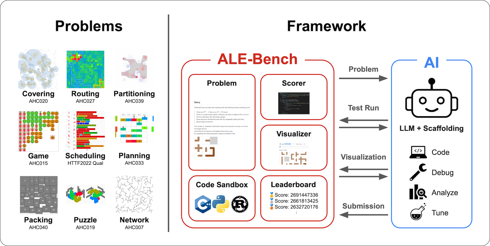

<!--
出典・補足：Sakana AI（2025年6月公開）https://sakana.ai/ale-bench-jp/ 、https://arxiv.org/html/2506.09050v1 Figure 1。図：https://sakana.ai/assets/ale-bench/ale-overview-border.png を加工せず掲載。AHCの過去問40問を収録したベンチマークの構成図。原図中のAIという表記は原著者によるもの。
-->

---

# LLM とヒューリスティック最適化
## ALE-Bench：LLM が作るソルバの強さ

4 月時点で既に暖色レベルのモデルが存在し、**gpt-6-astra の登場で開発の進め方が大きく変わった**。

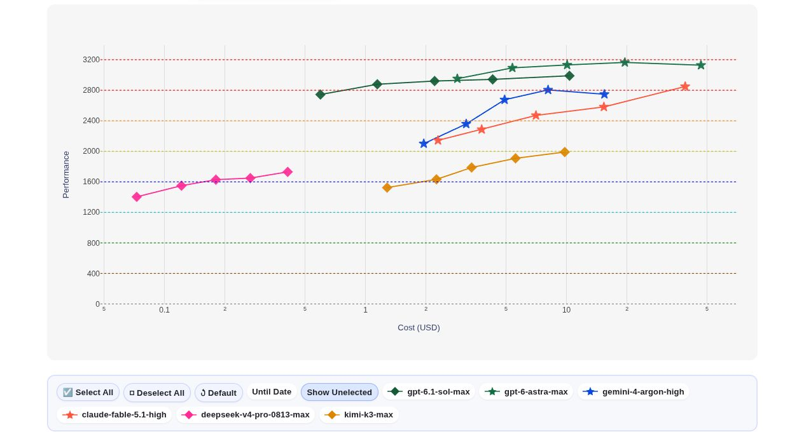

<!--
出典・補足：ALE-Bench公式リーダーボード https://sakanaai.github.io/ALE-Bench-Leaderboard/ （更新日：2026年10月18日、取得日：2026年10月21日）。公式ページのOverall Leaderboardを画面から取得。Problem Set=All、Vertical Metric=Performance、Horizontal Metric=Cost (USD)、縦軸Linear・横軸Log。表示機能でgpt-6.1-sol-max、gpt-6-astra-max、gemini-4-argon-high、claude-fable-5.1-high、deepseek-v4-pro-0813-max、kimi-k3-maxを選択した。図は再描画せず、公式のグラフと凡例を掲載。各点はSelf-refine回数の異なる設定を表す。平均パフォーマンスは全40問の平均で、人間のAtCoderレーティングそのものではない。2800超は本図の評価設定での結果を指す。
-->

---

# LLM とヒューリスティック最適化
## ShinkaEvolve：グラフ形式でプログラムを改善する

**複数の候補へと分岐**させながら、LLM がプログラムを生成・改善する。

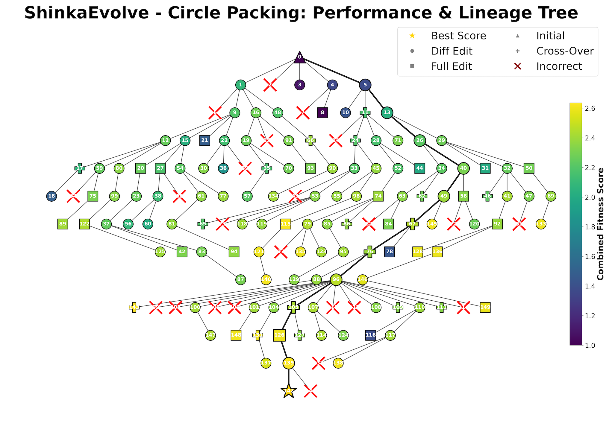

<!--
出典・補足：Sakana AI https://sakana.ai/shinka-evolve/ の円充填実験。公式図 https://sakana.ai/assets/shinka-evolve/circle_packing_evo_tree.png を加工せず掲載。参照日：2026年10月21日。番号は候補プログラムの識別子で、図の上下位置や番号を単純な時刻とはみなさない。図中のDiff Edit、Full Edit、Cross-Over、Initialは候補の生成方法を表す。グラフは円配置画像そのものの生成ではなく、円配置を求めるプログラムの探索を表す。本チームの進化的フレームワークの説明は第2章に置く。
-->

---

# LLM とヒューリスティック最適化
## ShinkaEvolve：生成したプログラムによる円充填

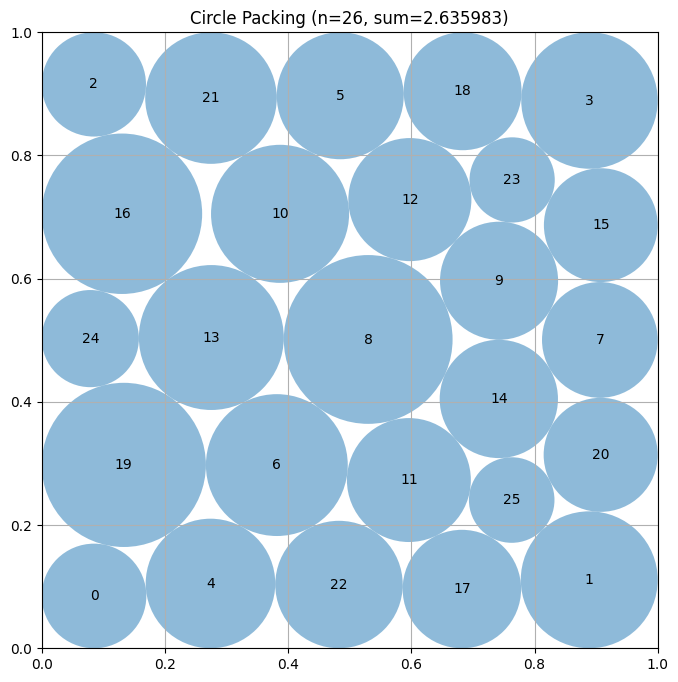

**26 個の円を正方形に詰める問題**

- 円が重ならないように配置し、**半径の合計を最大化**する。
- LLM が配置を求めるプログラムを生成し、実行結果を評価して改良する。
- 図は、プログラムが求めた配置を示す。

LLM が開発したプログラムから、具体的な最適化問題の解が得られる。

図：Sakana AI（2025 年 9 月公開）

<!--
出典・補足：https://sakana.ai/shinka-evolve/ のMathematical Optimization (Circle Packing)、https://arxiv.org/html/2509.19349v1 の円充填実験とListing 2。図：https://sakana.ai/assets/shinka-evolve/circle_packing_soln.png を加工せず掲載。1辺1の正方形に26個の円を配置し、半径の和を最大化する。LLMが直接この画像を描くことを意味しない。前のスライドの探索グラフに対応する成果例。本チームでの応用は第2章で説明する。
-->

---

# LLM とヒューリスティック最適化
## OpenEvolve：多様なプログラムを保持して改善する

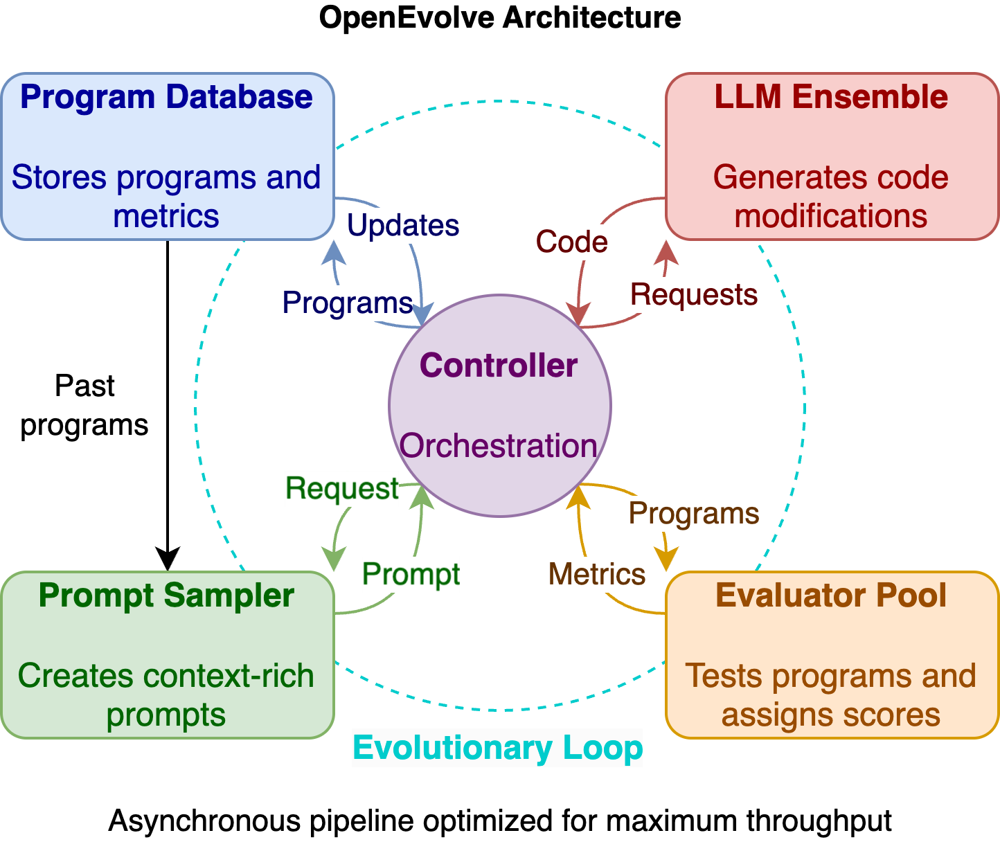

初期プログラムと評価方法を与えると、LLM が改善を進めるオープンソースの仕組み。

1. 保存した候補から、改善のもとになるプログラムを選ぶ。
2. LLM が変更案を作り、実行して採点する。
3. 結果を保存し、次の候補の生成に使う。

**特徴の異なる候補**を残し、複数のグループで探索することで多様性を保つ。

<!--
出典・補足：OpenEvolve公式リポジトリ https://github.com/algorithmicsuperintelligence/openevolve のQuick Start、How OpenEvolve Works、Core Innovation: MAP-Elites + LLMs。構成図：https://raw.githubusercontent.com/algorithmicsuperintelligence/openevolve/main/openevolve-architecture.png を加工せず掲載。参照日：2026年10月21日。MAP-Elitesによる特徴空間内の候補保持と、island-based architectureによる複数集団での探索を平易に要約した。候補生成では親プログラムのほか、参考候補や評価結果も利用する。OpenEvolveそのものを本チームが採用したという意味ではなく、関連する公開の取り組みとして紹介する。
-->

---

# LLM とヒューリスティック最適化
## プログラムの生成・改善で意識する 3 つの要点

先行研究を参考に、本チームでは開発方針を次の 3 点に整理した。

| 要点 | 開発で意識すること |
| :--- | :--- |
| **Sampling** | プログラムを新しく生成し、異なる出発点を試す |
| **Self-refine** | 実行・評価の結果を返し、有望なプログラムを繰り返し改善する |
| **多様性** | 似た方針ばかりに偏らないよう、異なる候補を作り、残す |

異なる方針のプログラムを生成し、有望な候補を複数残して改善する。

<!--
出典・補足：先行研究の紹介を踏まえ、本チームの開発方針をSampling・Self-refine・多様性の3点に整理したもの。各研究の全要素をこの3点だけで説明するという主張ではない。候補の新規構築と独立性の確保については、ユーザー提供の活動メモとソルバ強化の運用に基づく。具体的なソルバ群の評価・入れ替え手順は第2章で説明する。
-->

---

# LLM とヒューリスティック最適化
## Sampling と Self-refine

- プログラムを新しく生成することを **Sampling** と呼ぶ。
- 評価結果を使ってプログラムを改善することを **Self-refine** と呼ぶ。

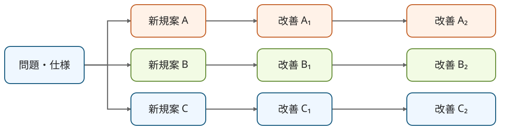

初期の方針が偏ると、改善を重ねても別の有力な方針に届きにくい。
$\to$ **複数の出発点**を試し、有望な案を継続して改善する。

<!--
出典・補足：概念図。本資料のSelf-refineは実行評価を返す反復改善を指す。関連：<a href="https://arxiv.org/html/2506.09050v1">ALE-Bench §4・§5.2</a>。
-->

---

# LLM とヒューリスティック最適化
## 開発環境：アルゴリズム・テスト環境・マシン活用

競技部門で重要な**アルゴリズム・テスト環境・マシン活用**の 3 つを、LLM が使える形にする。

| 要素 | 整えること | LLM が進められること |
| :--- | :--- | :--- |
| アルゴリズム | 問題の制約・解法の知見を整理する | 方針を具体的なコードにし、試す |
| テスト環境 | 実行・採点・比較を一連の操作にする | 結果を確かめながら改善を繰り返す |
| マシン活用 | 使える計算資源と操作方法を用意する | 並列化・分散化と、その検証を進める |

人間は結果を考察し、解法を理解・共有して、**評価方法や運用を見直す**。

<!--
出典・補足：ユーザー提供の活動メモに基づく開発方針。LLMにとって扱いやすいプロジェクトはテスタに限らず、問題・解法の知見、評価操作、計算資源へのアクセスを含む。具体的なテスト環境は第3章、解法の分析とマシン活用は第4章で説明する。
-->

---

# LLM とヒューリスティック最適化
## 開発方針：人間と LLM が並行して開発する

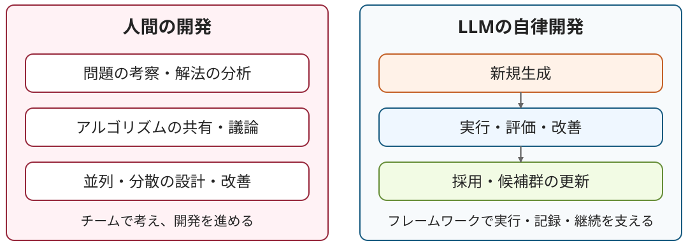

**人間が毎回介在しない試行**も走らせ、固定観念や最初の解法選びに縛られないようにする。

<!--
出典・補足：ユーザー提供の活動メモと、本資料の第2章（独立した候補の再構築・評価・採用条件・Skills）、第4章（解法のホワイトボックス化と並列・分散設計）に基づく開発方針。人間による考察・開発と、LLMによる新規生成を含む自律開発を、並行して進める別々の活動として整理した。図では両者を接続せず、それぞれの活動を示している。候補開発へ旧実装や他ソルバの設計履歴を引き継がせたという意味ではない。フレームワークの具体的な実現方法や、運用上の課題は後続章で扱う。
-->

---

<!-- _class: chapter -->
<!-- CHAPTER_APPLICATION -->

# 2. 本問題への応用

## 対戦ゲームに強く多様なソルバ群の作り方

---

# 本問題への応用
## 対戦ゲーム：相手の行動が道路状態を変える

- 全チームの車両の動きが、翌日以降の**道路状態**に影響する。
- 相手の経路が変わると、移動時間や有利な経路も変わる。
- 1 個の強いソルバだけでは、対戦での強さを評価しにくい。

| 評価に使う相手 | 残る課題 |
| :--- | :--- |
| 弱い相手だけ | 勝てていても、強い相手に通用するかは分からない |
| 強くても、似た設計の相手だけ | 行動の傾向が偏り、異なる戦略との相性を試せない |
| 固定した相手だけ | 改善が、その相手に勝つための調整に偏りうる |

$\to$ 評価には、**独立に作られた、多様で強いソルバ群**が必要になる。

<!--
出典・補足：道路状態の共有と更新：<a href="../../tester/game/docs/protocol.md">対戦ルール</a>、既存の<a href="../slide/slide.md">解法方針資料</a>。在庫や得点はチームごとに独立している。評価相手の強さ・多様性・更新の必要性は、ルールとチームの活動メモに基づく方針。特定のソルバ間の相性や過適合を実証した結果ではない。出題パターンの多さと評価時間の課題は第3章で扱う。
-->

---

# 本問題への応用
## 同じソルバの改善を続けたときの課題

- 同じソルバの改善を続けるだけでは、多様なソルバは生まれにくい。
- 解法が定まってくると、細かな変更に偏り、方針を見直しにくい。
- コードが肥大化し、以前のモデルの設計や会話履歴を引きずる。
- 次の指示を人間が出す運用では、24 時間の継続が難しい。

人間との共同改善や Self-refine に偏り、**Sampling と多様性が不足**しがちだった。

<!--
出典・補足：チームの経験に基づく課題整理。すべてのモデル・課題で起きると主張するものではない。
-->

---

<!-- _class: neighborhood-detail -->

# 本問題への応用
## ソルバ再構築：ゼロから作り、旧スコアを超える

9 月中旬ごろ、LLM に次の手順でソルバの再構築を依頼した。

1. ソルバを削除する。
2. 旧実装を引き継がず、ゼロから構築する。**旧スコアを超えるまで継続**する。

Sampling に<strong>「超えるまで継続」</strong>という条件を組み合わせた。

| 既存ソルバ | ゼロからの再構築 |
| :---: | :---: |
| **約 4 か月**かけて開発 | **約 1 時間**で作成 |
| 約 4,000 行 | 約 800 行 |
| 比較基準 | **旧ソルバのスコアを上回った** |

$\to$ この再構築を、**ソルバ群を繰り返し更新する仕組み**へ発展させる。

<!--
出典・補足：時間・行数・結果はチームの概数による振り返り。評価条件を揃えた一般的な生産性比較ではない。
-->

---

<!-- _class: neighborhood-detail -->

# 本問題への応用
## 進化的フレームワーク：最下位の再構築を繰り返す

5 個のソルバを競わせ、**最下位の再構築と入れ替え**を繰り返して、ソルバ群を強化する。

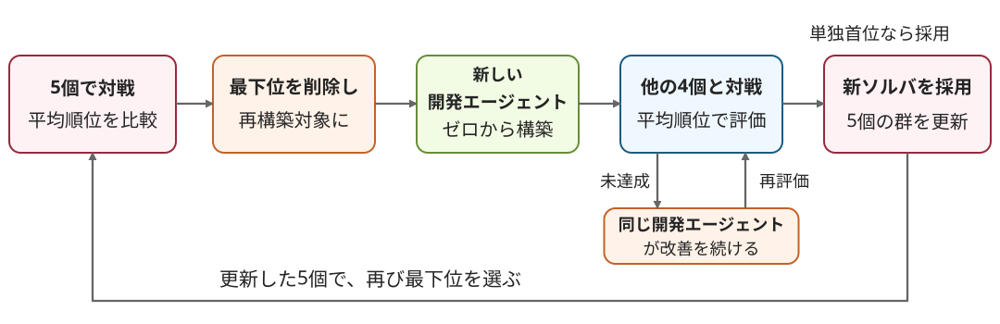

採用するのは、**他の 4 個すべてより平均順位が良いソルバ**のみ！
条件を満たすまで候補を改善し、採用後は更新したソルバ群で次の再構築へ進む。

<!--
出典・補足：出典：<a href="../../.agents/skills/procon37-solver-pool/SKILL.md">単一スレッドのソルバ強化スキル</a>。5個で対戦して平均順位最下位を再構築対象とし、残す4個は候補開発中に固定する。管理エージェントは評価・採用を担当し、開発エージェントは設計・実装・実験・改善を担当する。評価では全試合で5個すべてが正常終了し、新ソルバの平均順位が他4個すべてより厳密に小さいことが必要。個々の試合で必ず勝つという意味ではない。短縮テストとフルテストの使い分けは第3章で説明する。
-->

---

<!-- _class: neighborhood-summary -->

# 本問題への応用
## 管理・開発エージェントの役割分担

開発エージェントは、別の会話で動く**サブエージェント**。
管理エージェントが、**会話履歴を引き継がずに起動**する。

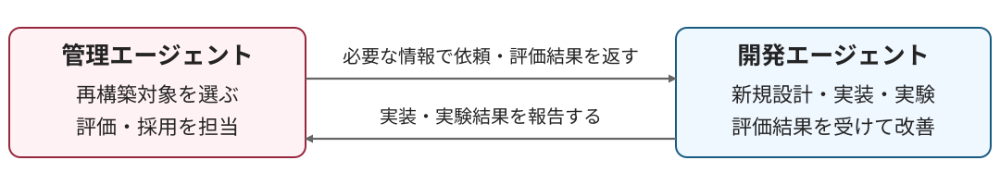

| 情報を絞る場所 | 具体的な方法 |
| :--- | :--- |
| 会話履歴 | 管理側・以前の開発エージェントの会話履歴を引き継がない |
| 依頼文 | 問題・公開仕様・テスト操作・編集範囲・採用条件を渡す |
| 共有ファイル | 旧実装を削除し、相手の実装や旧設計資料の閲覧を禁止する |

1 個の改善は同じ開発エージェントが続け、**次の再構築では新しく起動する**。

<!--
出典・補足：出典：<a href="../../.agents/skills/procon37-solver-pool/SKILL.md">ソルバ強化スキル</a>、<a href="../../.agents/skills/procon37-solver-pool/docs/developer-task.md">開発者への依頼文</a>、<a href="../../AGENTS.md">閲覧規則</a>。開発エージェントは管理エージェントから依頼を受けて別の会話コンテキストで作業するsubagent。起動時にfork_turns="none"を指定し、親の会話履歴を継承しない。依頼の目標は「残した4個を上回るソルバを、ゼロから作成せよ」。ファイルは共有されており、閲覧禁止は依頼文・AGENTS.mdによるルールであって、アクセス権限による強制隔離ではない。独立性は多様性を狙う工夫であり、アルゴリズムの多様性を保証しない。
-->

---

# 本問題への応用
## 生成・評価・選択でソルバ群を強化する

| 仕組みの要素 | この設計で狙うこと |
| :--- | :--- |
| 新規生成（Sampling） | 出発点を変えて、異なる方針のソルバを探す |
| 反復改善（Self-refine） | 評価結果を使い、新しい方針を採用に足る強さまで磨く |
| 選択・更新 | 強いソルバを残し、以後の対戦評価にも使う |

ソルバ群は開発の成果であると同時に、**次のソルバを鍛える評価環境**になる。

大会直前の数日間は、採用したソルバの Self-refine に集中した。

<!--
出典・補足：本チームの運用を進化的フレームワークとして整理したもの。新しい案の生成には既存案の変更や新規設計があり、保持・選択の規則は手法ごとに異なる。今回は独立した新規設計で多様性を狙い、評価・反復改善・採用を組み合わせる。大会直前のSelf-refineへの集中は、最初のチームメモに基づく。候補開発中の反復改善を否定する意味ではなく、採用済みソルバの最終調整に集中した時期を指す。独立した生成はアルゴリズムの多様性を保証せず、対戦相手の更新も未知の相手への強さの向上を保証しない。出典：<a href="../../.agents/skills/procon37-solver-pool/SKILL.md">ソルバ強化スキル</a>。関連：<a href="https://sakana.ai/shinka-evolve/">ShinkaEvolve</a>、<a href="https://github.com/algorithmicsuperintelligence/openevolve">OpenEvolve</a>。
-->

---

# 本問題への応用
## 進化的フレームワークを Skills で実現する

再構築・評価・採用の手順と判断条件を、**Skills に自然言語で記述**した。

| 用意したもの | 記述したこと |
| :--- | :--- |
| ソルバ群の強化スキル（SKILL.md） | 実行順序、役割分担、採用・継続条件 |
| 開発依頼のテンプレート | 開発エージェントへ渡す目標・仕様・作業範囲・閲覧規則 |
| 記録のルール | 対象ソルバ、進行段階、評価結果の保存方法 |

管理エージェントが記述された手順に従い、**ツール操作と開発エージェントへの依頼**を進める。

人間が毎回指示を出さなくても、ソルバ群の強化を**24 時間継続**できる！

<!--
出典・補足：出典：<a href="../../.agents/skills/procon37-solver-pool/SKILL.md">ソルバ強化スキル</a>、<a href="../../.agents/skills/procon37-solver-pool/docs/developer-task.md">開発依頼のテンプレート</a>。記録のルールは強化スキル内に定義され、実行状態・評価結果は別ファイルに保存する。Skills自体がプログラムとして処理を実行するのではなく、管理エージェントが参照して操作を進める。指定した更新回数などの終了条件まで継続する運用であり、無期限・無停止の実行を保証するものではない。テスト操作は第3章、マシンの操作は第4章、スクリプト化との比較は第5章で扱う。
-->

<!-- ---

# 開発中に変わった実感

| 時期 | チームの認識・取り組み（2026年） |
| :--- | :--- |
| 4月ごろ | LLMが「暖色レベル」のプログラムも書けるという実感。人間は環境構築・修正方針・考察・分析に比重を移す |
| 9月ごろ | Astraの利用と、LLMを継続的に動かすフレームワークの活用が進む |
| 9月中旬ごろ | 既存ソルバを引き継がず、ゼロから再構築する実験 |
| 大会直前 | 並列・分散構成へ展開し、採用したソルバを集中的に改善 |
 -->
<!--
出典・補足：時期・「暖色レベル」はチームの体験・表現。モデルの公式公開日や、特定ベンチマークの成績を示す年表ではない。
-->

---

<!-- _class: chapter -->
<!-- CHAPTER_TESTING -->

# 3. 試行錯誤を支えるテスト環境

## 多くの改善案を試して強さを比較する環境

---

# 試行錯誤を支えるテスト環境
## 評価の課題：マップと試合条件の多様性

同じ解法でも、配置や制約によって得意・不得意が変わる。

| 変わる条件 | 解法への影響 |
| :--- | :--- |
| 盤面サイズ（16×16・24×24・32×32） | 移動距離や、探索すべき経路の数が変わる |
| 地形・道路網 | 迂回の必要性、移動時間、燃料消費が変わる |
| スポットの配置・系列 | 訪問順序や、複数の車への担当分けが変わる |
| 燃料・ステップ数 | 補給の必要性や、1 日に巡れる範囲が変わる |
| 日数・混雑の基準 | 翌日以降を見越した計画の重要性が変わる |

**特定の条件だけに強くなっていないか**、多くのテストケースで確かめたい。

<!--
出典・補足：問題の要素と生成条件は<a href="../../tester/solo/docs/generator.md">入力生成</a>および<a href="../slide/slide.md">解法方針資料</a>に基づく。右列は各条件が探索に与える影響の整理であり、条件別の改善量を測定した表ではない。生成器の抽選分布を本番の出題分布と同一とはみなさない。
-->

---

# 試行錯誤を支えるテスト環境
## テストケース数と開発サイクルのトレードオフ

同じ計算資源・開発時間では、テストケース数によって次の違いが生じる。

| テストケース数 | 評価できる範囲 | 開発への影響 |
| :--- | :--- | :--- |
| 少ない | 特定の配置・条件に偏りやすい | 早く結果が返り、改善を何度も試せる |
| 多い | 幅広い配置・条件で弱点を探せる | 評価に時間がかかり、改善を試せる回数が減る |

$\to$ **評価範囲の広さ**と**改善を試せる回数**の両方を考慮する。

<!--
出典・補足：<a href="../../tester/solo/README.md">生成テストケースの構成</a>、<a href="../../tester/solo/docs/generator.md">入力生成</a>、<a href="../../tester/game/README.md">対戦テスタ</a>。同じ計算資源・開発期間で、同程度の実行時間を要するテストケースを増やす場合のトレードオフを定性的に整理した。テストケース数だけで評価の質が保証されるわけではなく、形式・配置・制約の偏りにも注意する。実際には公式サンプル・自動生成・非公式練習場の取り込みを組み合わせている。短縮テストは候補の絞り込みに使い、採用はフルテストで判断する。段階分けと並列実行の具体策はこの章の後続スライドで説明する。
-->

---

# 試行錯誤を支えるテスト環境
## 短縮テストとフルテストの使い分け

| 観点 | 短縮テスト | フルテスト |
| :--- | :--- | :--- |
| 目的 | 実装ミスの発見・有望な改善案の絞り込み | 採用してよいかを、本番の条件で判断 |
| 条件 | ソルバの制限時間を短くし、評価にかかる時間を減らす | **本番の制限時間**で実行 |
| 判断 | 改善の方向を判断するための暫定結果 | 結果で採用を判定する |

**変更 → 短縮テスト → 有望ならフルテスト → 基準を満たせば採用**

不具合や悪化が見つかったら修正へ戻る。

<!--
出典・補足：<a href="../../.agents/skills/procon37-solver-pool/SKILL.md">強化スキル</a>、<a href="../../README.md#テスト">フルテストの定義</a>、<a href="../../solver/docs/distributed/README.md">分散開発の評価条件</a>、<a href="../../solver/docs/distributed/resume-20261009/formal-time-audit-20261009.md">正式時間の監査</a>。今回の短縮テストは、ソルバの実行時間を短くすることで評価を軽くし、多くの候補を試すために用いた（チームの運用に関する補足）。フルテストはすべての可能なマップを網羅する意味ではなく、規定の評価セットを省略せず実行すること。単一スレッドの対戦では30試合であり、具体的な採用条件は後続スライドで説明する。制限時間を縮めると探索や通信の振る舞いも変わり得るため、短縮テストの成績から本来の条件での強さを保証することはできない。
-->

---

# 試行錯誤を支えるテスト環境
## テストの並列化：複数のケースを同時に評価する

評価の待ち時間を短くすることで、**改善を試せる回数を増やす**。

- **別々のテストケース**を同時に実行し、結果をまとめて集計する。
- ソルバが 1 スレッドでも、テスト全体では複数の CPU コアを使える。
- 同時実行数は、対象ソルバと対戦相手が使う計算資源に合わせる。
- CPU を取り合って各ソルバの探索時間が不足しないようにする。

<!--
出典・補足：<a href="../../tester/solo/README.md">単独テスタの並列実行</a>、<a href="../../tester/game/README.md">対戦テスタの同時試合数</a>。ここでの並列化は複数テストケースの同時評価。1試合内で複数の探索を動かすソルバの並列化は第4章で説明する。
-->

---

# 試行錯誤を支えるテスト環境
## 開発レイヤーに応じてテスタを使い分ける

多くの解法を試せることと、本番に近い条件で評価できることの両方を重視する。

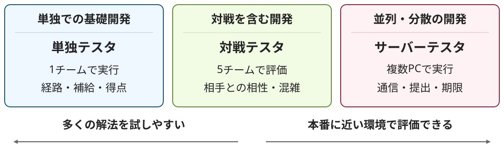

**各レイヤーに対応するテスタ**を使い、短縮テストとフルテストを行う。

<!--
出典・補足：<a href="../../tester/README.md">テスタ一覧</a>、<a href="../../tester/server/README.md">サーバーテスタ</a>、<a href="../../common/README.md">共通基盤</a>。図は開発レイヤーと使用するテスタの対応を示し、毎回すべてを順番に通すテスト手順を示すものではない。レイヤーに応じた運用とトレードオフ：チームメモ。図中の軸は同じ開発時間・計算資源を前提とした定性的な整理であり、試行回数の実測比較ではない。
-->

---

# 試行錯誤を支えるテスト環境
## デプロイ：改善したソルバを次のレイヤーへ展開する

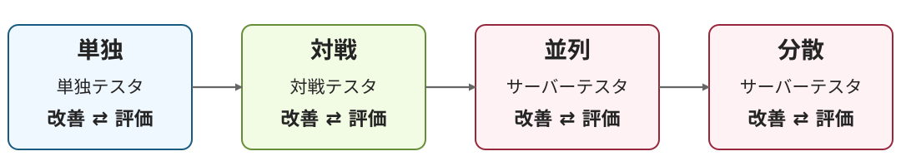

- 様々な解法や改善案を試し、ソルバを強化する。
- 有望なソルバを並列・分散構成へ展開し、試験用 PC に配置する。
- **移行先のテスタで動作と強さを確認**し、そのレイヤーで再び改善する。

解法を磨く時間と、本番に近い環境で確かめる時間の両方を確保する。

<!--
出典・補足：開発方針：チームメモ。図は各変更の必須テスト順序ではなく、開発レイヤー間でソルバを展開する流れを示す。デプロイには、改善した実装を次の構成へ組み込み、対象PCに配置して動かすことを含む。並列・分散の実装内容は第4章、移行が遅れた反省は第5章で説明する。構成・配置：<a href="../../solver/docs/distributed/README.md">分散開発記録</a>。
-->

---

<!-- _class: neighborhood-detail -->

# 試行錯誤を支えるテスト環境
## 各レイヤーのソルバ構成と計算資源

| レイヤー | テスタ | ソルバの構成 | 試験環境全体 |
| :--- | :--- | :--- | :--- |
| 単独 | 単独テスタ | 1 T | 32 T |
| 対戦 | 対戦テスタ （5 チーム） | 1 T × 5 個 | 32 T |
| 並列 | サーバーテスタ （6 チーム） | 15 T × 4 個 ＋ 1 T × 2 個 | 32 T × 2 台 ＋ 16 T × 1 台 |
| 分散 | サーバーテスタ （4 チーム） | 80 T の分散 1 個 ＋ 16 T の並列 1 個 ＋ 1 T × 2 個 | 32 T × 3 台 ＋ 16 T × 2 台 |

T は論理スレッド数を表す。
並列・分散では、16 T の PC に 1 T ソルバとサーバーテスタを配置する。

<!--
出典・補足：環境全体の台数・サーバー配置：チームメモ。ソルバ配分：<a href="../../.agents/skills/procon37-parallel-solver-pool/SKILL.md">並列強化スキル</a>、<a href="../../solver/docs/distributed/README.md">分散構成</a>。
-->

---

# 試行錯誤を支えるテスト環境
## LLM 向けの設計：CUI・GUI・Skills を揃える

| 設計上の工夫 | LLM から使うときの利点 |
| :--- | :--- |
| CUI を操作の基本にする | 実行条件をコマンドで指定し、テストの実行・集計・比較を繰り返せる |
| CUI と GUI の基盤を共通化 | 履歴を共有し、CUI で評価した結果をそのまま GUI で確認できる |
| ブラウザで動く GUI | LLM の内部ブラウザで盤面やリプレイを見て、LLM が分析を行える |
| 操作手順を Skills に集約 | 起動方法に加え、実行・比較・可視化の使い分けまで手順として渡せる |

**実行・結果確認・操作手順**を、まとめて LLM へ渡す。

<!--
出典・補足：設計方針は最初のチームメモ「CUIを作成、GUIはCUIのwrapperとして開発」「AIの内部ブラウザが見ることができるように」「使い方をまとめたskillsを作成」に基づく。実装上はGUIがCUIコマンドを呼ぶ構造ではなく、CUIとGUIが問題生成・判定・実行・履歴などの共通基盤を使う。このため本文では、CUIを基本に同じテスト機能をGUIからも使う方針として表現した。参照：<a href="../../tester/README.md">テスタ一覧</a>、<a href="../../common/docs/design.md">共通基盤の構成</a>、<a href="../../.agents/skills/procon37-tester/SKILL.md">テスタ操作スキル</a>。フレームワークの進行管理は第2章、試験用PCへの接続・操作は第4章で扱う。
-->

---

<!-- _class: chapter -->
<!-- CHAPTER_RESOURCES -->

# 4. アルゴリズムとマシン活用

## 解法の理解と並列・分散処理への展開

---

# アルゴリズムとマシン活用
## 学内の知見を組み合わせる

| 知見 | 開発への活かし方 |
| :--- | :--- |
| 2022 年の明石高専・競技部門の経験 | 並列分散処理を活かし、5 位に入った経験を聞く |
| 自由部門のメンバー | LLM 戦略について議論する |
| 競プロや研究に詳しいチームメイト | アルゴリズムとテスト環境への助言を得る |

分野ごとの知見を、LLM の力も借りながら**アルゴリズム・テスト環境・マシン活用へ統合**した。

<!--
出典・補足：学内の経験・交流・2022年の順位に関する記述：チームの振り返り。
-->

---

# アルゴリズムとマシン活用
## 解法の理解：アルゴリズムのホワイトボックス化

LLM が出力したプログラムを、**人間が考察・議論できる**アルゴリズムとして捉え直す。

1. 何を解として持ち、どう評価し、どう変更しているかを整理する。
2. 多様なソルバの共通点・違いと、得意・不得意な条件を洗い出す。
3. 活動で共有・議論し、図と数式を使った詳細な解説スライドを作成する。
4. 得た知見から、フレームワーク設計・テスト環境を見直す。
5. 論文調査や、ソルバの並列・分散化の議論にも活かす。

$\to$ 整理した知見を**フレームワーク・テスト環境へ反映**し、さらにソルバを改善する。

<!--
出典・補足：チームの振り返りと、解法のホワイトボックス化をフレームワークの改善へ還元するという開発方針。候補生成・評価・資源配分は、得た知見をもとに見直す対象を示しており、個々の変更による効果を検証済みという意味ではない。旧実装や対戦相手の設計履歴を開発エージェントへ渡すこととは区別する。整理した解法は<a href="../slide/slide.md">既存スライド</a>と<a href="../../solver/docs/algorithm.md">分散ソルバの説明</a>を参照。
-->

---

# アルゴリズムとマシン活用
## 解法の共有：図・数式・具体例で整理する

全 40 枚の解説スライドで、評価関数・経路・近傍操作・並列分散処理を整理した。
説明する過程で知見を整理し、チーム内や LLM との議論、実験結果の考察に活かした。

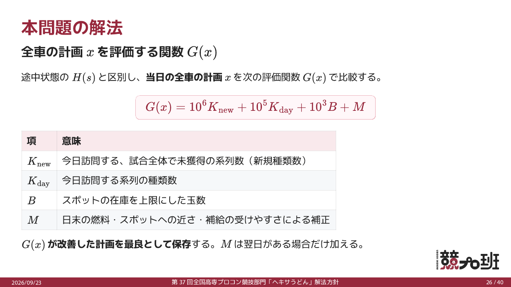

評価関数を数式と表で説明

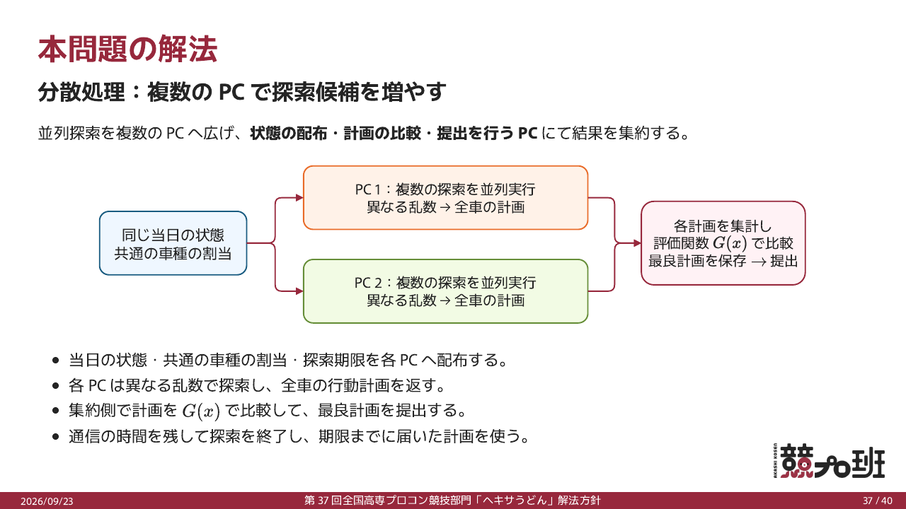

分散処理の考え方を図で共有

<!--
出典・補足：<a href="../slide/slide.pdf">「ヘキサうどん」解法方針（全40枚）</a>の26・37ページを抜粋。右図は考え方の説明図で、最終的な3台構成とは異なる。
-->

---

# アルゴリズムとマシン活用
## 並列処理：異なる探索を同時に走らせる

同じ問題から、乱数・温度・評価の重みが**異なる探索**を同時に走らせる。

- 独立した探索を、複数の CPU スレッドで同時に動かす。
- 各探索は**全車の行動計画**を持ち、有望な計画を共有する。
- 制限時間内に得た計画を評価し、提出する回答を選ぶ。

<!--
出典・補足：<a href="../../solver/docs/algorithm.md">分散ソルバのアルゴリズム</a>と既存の<a href="../slide/slide.md">解法方針資料</a>。第3章のテスト並列化は複数テストケースの待ち時間短縮、このスライドのソルバ並列化は1試合に使う探索資源の増加を目的とする。
-->

---

# アルゴリズムとマシン活用
## Rust の採用：CPU 並列化を支える言語の仕組み

- 高速な CPU 探索と、複数スレッドでの実行を見据えて Rust を選択した。
- 所有権・借用・型検査で、不正なデータ共有などを**コンパイル時に検出**する。
- `Send` / `Sync` が、スレッド間で移動・共有できる型を制約する。
- チームメンバーに Rust 経験者はいなかった。
- **コードは LLM に任せ**、自分たちでは書かず・読まずに開発を進めた。
- 人間は、解法のホワイトボックス化・議論・フレームワーク設計などに集中した。

コンパイラの指摘から LLM が修正できることが、並列化を任せる上で利点になる。

<!--
出典・補足：言語選択の意図・チームの経験：チームメモ。技術的な利点はRust公式の<a href="https://doc.rust-lang.org/book/ch16-00-concurrency.html">Fearless Concurrency</a>、<a href="https://doc.rust-lang.org/book/ch16-04-extensible-concurrency-sync-and-send.html">SendとSync</a>、<a href="https://doc.rust-lang.org/book/ch16-03-shared-state.html">Shared-State Concurrency</a>に基づく。所有権・型検査は多くの並行処理の誤りをコンパイル時に検出する。Sendは所有権を別スレッドへ移動できること、Syncは共有参照を複数スレッドから安全に使えることを表す。safe Rustのデータ競合防止は、利用するライブラリ内のunsafe実装やFFIが安全性の契約を守ることを前提とする。デッドロック、一般的な競合状態、ロジックの誤り、並列性能はコンパイル成功だけでは保証されない。コンパイラの診断をLLMの修正に活かせるという記述は、これらの性質に基づく開発上の考察であり、他言語との比較実験の結果ではない。参照日：2026年10月21日。
-->

---

# アルゴリズムとマシン活用
## 分散処理：複数の PC の探索を協調させる

複数の PC の探索を協調させ、1 チームの計算資源を増やす。

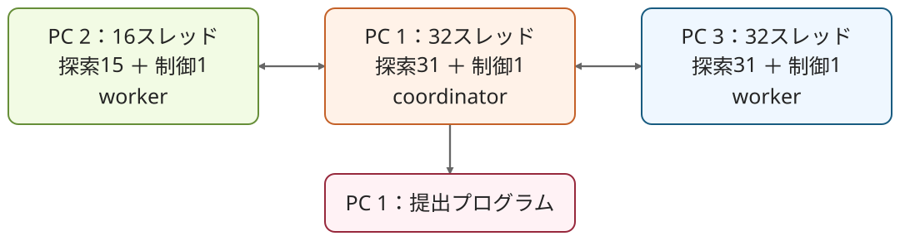

合計**80 スレッド**（探索 77・制御 3）を使い、提出プログラムは別プロセスで動かす。
各 PC で並列に探索し、良い計画を共有する。回答は PC 1 で集約して提出する。

<!--
出典・補足：<a href="../../solver/docs/algorithm.md">分散ソルバの並列・分散構成</a>。80スレッドは計算資源の合計であり、80倍の高速化を意味しない。集約・配信はcoordinator、HTTP提出は別プロセスの提出プログラム（実装名：bridge）が担う。探索・解共有・状態同期の詳細は次のスライドで説明する。
-->

---

# アルゴリズムとマシン活用
## 分散処理：探索・計画の共有・回答の提出

| 処理 | 仕組み |
| :--- | :--- |
| 探索開始 | 同じ問題・観測・採用済みの履歴を 3 台に渡し、探索の前提を揃える |
| 各 PC で探索 | 各探索は全車の行動計画を持ち、乱数・温度・評価の重みを変えて探索する |
| 計画の共有 | PC 間で良い計画を共有し、**受信側で再評価**して探索に取り込む |
| 回答の提出 | PC 1 で回答を集約して途中回答も提出し、通信を待ち続けず制限時間を守る |
| 翌日の状態同期 | 実際に**採用された回答に状態を合わせ**、3 台で次の探索を始める |

共有した計画を別の探索でさらに改善し、制限時間中に得られた有効な回答を使う。

<!--
出典・補足：<a href="../../solver/docs/algorithm.md">分散ソルバの解共有・中間回答・状態同期</a>。各探索は全車分の計画を持ち、PCごとに車両や地図の一部を分担する構成ではない。PC間で共有した当日計画は入力・状態の一致を検査し、受信側で再評価して取り込む。機間共有は500ms周期を目安とし、更新がない場合は送信しない。集約・配信はcoordinator、HTTP提出はbridgeが担う。bridgeが確認した回答の採否と実際の観測を次の要求に反映し、採用されなかった計画を実行済みとして引き継がない。
-->

---

# アルゴリズムとマシン活用
## 開発環境：LLM が実行用 PC を操作する

全 PC を有線 LAN でつなぎ、**操作権限と手順**を渡す。

| 用意したもの | LLM による開発 |
| :--- | :--- |
| 全実行用 PC の操作権限 | SSH で各 PC を操作し、環境構築・ネットワーク設定・ファイル操作まで行う |
| 接続・運用の Skills | 接続方法と計算資源を把握し、複数 PC での配置・実行・ログ確認を進める |
| 軽量な Void Linux | OS の負荷を抑え、計算資源をソルバの探索に回せる |
| USB 起動の試験環境 | 普段の環境と分け、LLM が設定やツールを自由に変更しながら試せる |

実装 → ビルド・配置 → 複数 PC で実行 → ログ確認・修正

複数 PC を使う開発サイクルを、LLM 自身が操作して回せるようにした。

<!--
出典・補足：全PCを有線LANで接続し、試験用PCの操作権限をLLMに与え、専用のSkillsを用意したというチームメモに基づく。権限の範囲は試験用PCでのSSH操作、環境構築、ネットワーク設定、ファイル操作など。参照：<a href="../../.agents/skills/procon37-ssh/SKILL.md">試験用PCの接続・操作スキル</a>、<a href="../../solver/docs/distributed/README.md">分散開発記録</a>。USB起動で普段の環境と分け、LLMが変更しやすい試験環境とした。Void Linuxは探索に計算資源を回すため軽量さを重視して選択し、本番の操作ミスを避けるためGUIは残した。WindowsやGNOME構成のUbuntuとの性能比較を測定したという意味ではない。
-->

---

<!-- _class: chapter -->
<!-- CHAPTER_REFLECTION -->

# 5. 反省とまとめ

## 開発で得た成果と次回に向けた改善点

---

# 反省とまとめ
## 並列・分散への移行が遅れた

| 段階 | 開発の経緯 |
| :--- | :--- |
| 当初の方針 | 単一スレッド版の改善が頭打ちになったら、並列・分散構成へ移行する |
| 実際の経過 | 単一スレッド版の改善が続き、次のレイヤーへ進む判断が遅れた |
| 結果 | デプロイは**大会 3 日前**からとなり、分散処理を十分に改善できなかった |

並列・分散は、配置・通信確認・評価に時間がかかり、**1 回の開発サイクルも長い**。
移行が遅れたことで、残された期間に試せる改善の回数が限られた。

$\to$ 性能の停滞だけを待たず、**移行後に試行錯誤する時間**も確保したい！

<!--
出典・補足：最初のチームメモの「並列分散処理へのデプロイがギリギリ：大会3日前から」「単一スレッドの改善が頭打ちにならなかったため」「分散処理の十分な改善ができなかった」に基づく。当初の移行方針は同メモの「改善が止まったら、すぐにデプロイを行う」に対応する。並列・分散処理では開発サイクルを回すのに時間がかかるというチームの補足を反映し、配置・通信確認・評価を含むサイクルの長さと、大会までに残る期間の両方を考慮するという次回方針を併記した。ALE-Benchの改善曲線はモデル・課題・設定に依存し、改善速度の普遍的な「対数則」とは扱わない。
-->

---

# 反省とまとめ
## 分散処理のフルテストが遅れた

- 実行時間を短縮すると、通信による解の共有と、その後の探索に使える時間が変わる。
- 短縮テストの結果だけでは、**本番時間での改善を判断できなかった**。
- 気づいたのは**大会前日**で、本番時間での検証が直前に集中した。

| 評価する対象 | テストの使い分け |
| :--- | :--- |
| 通常の候補の比較 | 短縮テストで多くの候補を試し、有望ならフルテストへ進む |
| 分散処理の性能・通信タイミング | 短縮テストだけで絞り込まず、早い段階からフルテストで比較する |

この使い分けを、早めに導入すべきだった。

<!--
出典・補足：今回の分散処理の性能評価では短縮テストが有効でなかったこと、気づいたのが大会前日で検証が夜遅くまで及んだこと、「短縮テスト→フルテスト」を早めにSkillsへ指定すべきだったことはチームの振り返り。全てを本番時間で評価すると開発に時間がかかる一方、分散処理の通信タイミングは短縮テストでは測りにくかった。基本動作や大きな退行の確認まで短縮テストが無効という意味ではなく、今回の性能比較に関する反省として記載した。技術的背景：<a href="../../solver/docs/distributed/resume-20261009/frequency16-20261010/communication-considerations.md">共有周期と評価時間の考察</a>。記録の比較条件は10秒の短縮試験と16×16・公式60秒。
-->

---

# 反省とまとめ
## フレームワークの調査・比較が不足した

**既存手法の調査不足**

- 対戦ゲーム向けの LLM 開発フレームワークを十分に調査できなかった。
- 過去のモデルを前提にした手法が、現在のモデルでも有効なのか検討したかった。

**Skills とスクリプトの比較**

- スクリプト化が難しいと感じ、Skills でフレームワークを作った。
- Skills は自然言語で規則を変更し、別の条件にも流用しやすかった。
- 実装の手間も含め、スクリプトで実装する方がよかったか検討したかった。

既存手法の調査と、Skills・スクリプトの比較を進め、フレームワーク設計を見直したい。

<!--
出典・補足：最初のチームメモの、対戦ゲーム向けフレームワークを調査する時間がなかったこと、過去のモデル向け手法がastraでも有効かという疑問、スクリプト化へのハードル、Skillsを自然言語で変更・流用できる利点と実装の手間のトレードオフに基づく。「もっと詳細に検討し、より良いものを作れたのではないか」というチームの反省として整理した。既存手法やSkillsとスクリプトの優劣を比較実験で確認したという意味ではない。
-->

---

# 反省とまとめ
## 再構築をまたぐ知見の継承が不足した

ゼロから作り直すたびに、知見の継承が途切れた。

**多様な解法を得るための工夫**

- 新しい開発エージェントを起動する。
- 旧実装・開発履歴を渡さず、既存の解法に縛られない設計を促す。

**残った課題**

- 管理側には評価結果・実行記録を残した。
- そこから得た知見を、次の新規開発に引き継ぐ仕組みがなかった。

過去の解法に過度に誘導せず、**何を・どこまで引き継ぐか**を設計する。
新しい方針を探す自由と、試行錯誤から学ぶ仕組みを両立させたい。

<!--
出典・補足：最初のドラフトの「破壊について、知見を全て壊しているので、非効率ではある」に基づく。<a href="../../.agents/skills/procon37-solver-pool/SKILL.md">実際の運用</a>では、管理側には評価結果・実行記録・状態を保存する一方、新しい開発エージェントには親の会話、旧実装、他の候補の設計履歴を引き継がせない。チームの記録そのものを全て削除したという意味ではなく、再構築をまたぐ知見の継承について述べている。同じ候補を開発する間に評価結果を返して改善する手順とは区別する。「発想の独立性」は既存の解法や開発履歴に縛られずに新規設計することを指し、その目的がソルバ群の多様性を得ることにある。アルゴリズムの多様性や統計的な独立性を保証する意味ではない。具体的な継承方法は未確定のため、現状の課題と両立させたい方向性のみを記載する。
-->

---

# 反省とまとめ
## モデルの大きさに応じた役割分担を試したかった

今回は、大きなモデルによる設計・再構築を重視した。
小さなモデルで細かな改善を大量に試す方法も、組み合わせて検討したかった。

| 次に試したい役割分担 | 変更の範囲 | 作業の例 |
| :--- | :--- | :--- |
| 大きなモデル | 解法全体を見直す | 新規設計・再構築、探索方針の変更 |
| 小さなモデル | 対象を絞って改善する | 高速化、パラメータや近傍操作の調整 |

ソルバの強化と、AI の利用料金の削減を両立したい。

- 細かな改善を小さなモデルに任せ、大きなモデルを使う費用を抑える。
- **同じ予算で、より多くの改善案**を試すことを目指す。

<!--
出典・補足：最初のチームメモの「大きなモデルで粗い動作を行うことに重きを置いた」「小さなモデルに細かな改善を大量に行わせることも考えたり、組み合わせたりしたかった」に基づく。モデルの役割分担には、ソルバの改善だけでなくAIの利用料金を抑える狙いもあるというユーザーの補足を反映した。表と費用削減・試行数拡大の狙いは、今後の実験案であり、実測した成果ではない。今回、全てのエージェントに同じ大きなモデルを使ったという意味ではなく、ソルバを開発する役割についての反省。<a href="../../.agents/skills/procon37-solver-pool/SKILL.md">運用スキル</a>には管理と開発で別のモデル指定がある。モデルが小さければ必ず高速・低費用になる、細かな改善に優れる、または多数の試行により強くなると実証したわけではない。実際の費用はモデルの料金と利用量に依存する。候補評価自体にも計算時間がかかるため、生成だけでなく評価を含めて比較する。
-->

---

# 反省とまとめ
## まとめ

**人間の開発と並行して、「実用的なアルゴリズムエンジニアリングの自動化」を進めた。**
様々なマップパターンと対戦ゲームに合わせて、開発・評価の仕組みを整えた。

- 人間は問題を考察し、**テスト環境とマシン活用を設計**する。
- LLM は自律的に**実装・実験・改善**を進め、多様な方針を試す。
- 得られた解法をチームで整理・議論し、次の開発へ活かす。

この戦略が準優勝に大きく寄与した！

<!--
出典・補足：表現の出典：<a href="https://sakana.ai/ale-bench-jp/">Sakana AI：ALE-Bench</a>。開発方針・準優勝への寄与：チームの振り返り。
-->

---

# 参考文献

1. **Yuki Imajuku, Kohki Horie, Yoichi Iwata, Kensho Aoki, Naohiro Takahashi, Takuya Akiba.**\
   [*ALE-Bench: A Benchmark for Long-Horizon Objective-Driven Algorithm Engineering.*](https://arxiv.org/abs/2506.09050)\
   arXiv preprint, arXiv:2506.09050, 2025.

2. **Robert Tjarko Lange, Yuki Imajuku, Edoardo Cetin.**\
   [*ShinkaEvolve: Towards Open-Ended And Sample-Efficient Program Evolution.*](https://arxiv.org/abs/2509.19349)\
   arXiv preprint, arXiv:2509.19349, 2025.

3. **Asankhaya Sharma.**\
   [*OpenEvolve: an open-source evolutionary coding agent.*](https://github.com/algorithmicsuperintelligence/openevolve)\
   GitHub, 2025.

<!--
出典・補足：著者・題名・年はarXivの書誌情報およびOpenEvolve公式リポジトリのCitationに基づく。確認日：2026年10月21日。研究内容の紹介と、本チームが実装した強化手順は区別して記載した。
関連する解説・図版・実装：ALE-Bench日本語解説 https://sakana.ai/ale-bench-jp/ 、構成図 https://sakana.ai/assets/ale-bench/ale-overview-border.png 、公式リーダーボード https://sakanaai.github.io/ALE-Bench-Leaderboard/ 。ShinkaEvolve紹介 https://sakana.ai/shinka-evolve/ 、公式実装 https://github.com/SakanaAI/ShinkaEvolve 、円配置図 https://sakana.ai/assets/shinka-evolve/circle_packing_soln.png 、探索グラフ https://sakana.ai/assets/shinka-evolve/circle_packing_evo_tree.png 。OpenEvolve構成図 https://github.com/algorithmicsuperintelligence/openevolve/blob/main/openevolve-architecture.png 。各図の出典・取得条件は掲載スライドのノートに記載。
-->
