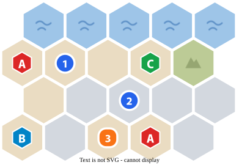
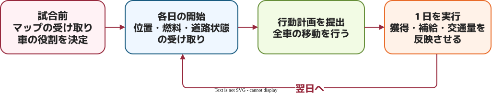
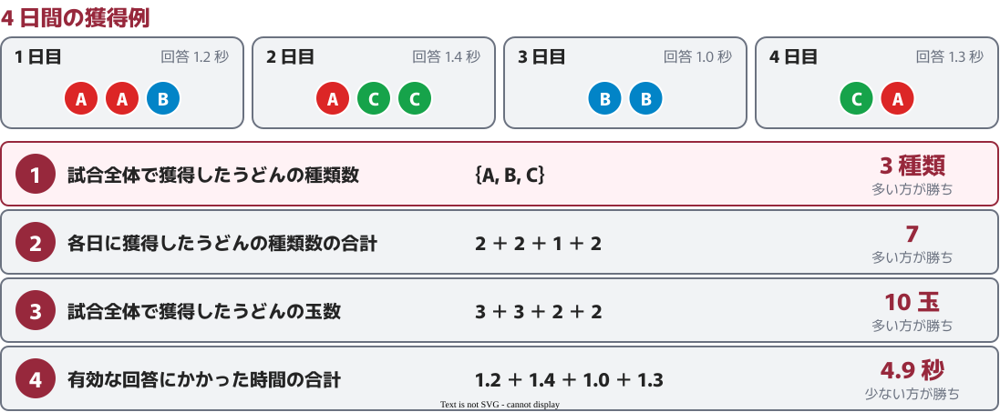
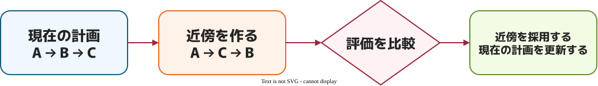
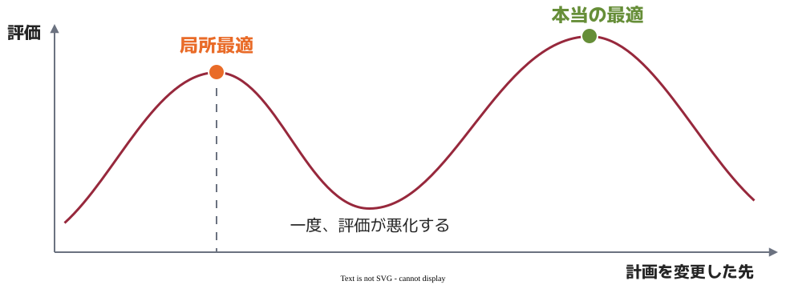
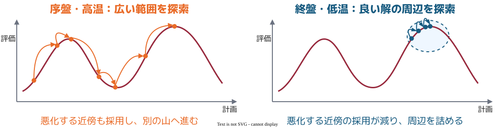
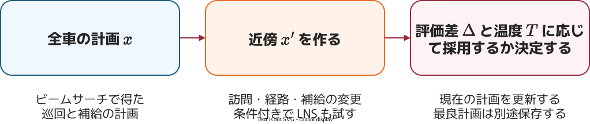
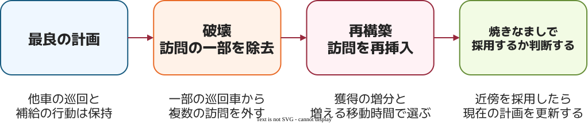

<!-- _class: title -->

## 第 37 回高専プロコン競技部門
# 「ヘキサうどん」解法方針

**30009 明石高専チーム「淵底」**
**笠井 瑛司 / 上 天将 / 布谷 太一**

---

# 目次

## 1. 「ヘキサうどん」の問題概要
## 2. 「ヘキサうどん」の性質および考察
## 3. 焼きなまし法とは
## 4. 本問題の解法

---

<!-- _class: chapter -->
<!-- CHAPTER_PROBLEM -->

# 1. 「ヘキサうどん」の問題概要

---

# 問題概要

六角形のマップ上にある車を動かし、各地の**うどんスポット**を巡る。
スポットを効率よく巡り、**たくさんうどんを集めた人**が勝利！🏆️

---

# 問題概要

六角形の**セル**には平地、山地、池、道路の 4 種類の**地形タイプ**が割り当てられており、平地セルのいずれかに**スポット**が設置されている。プレイヤーはセル上の**巡回車**、**補給車**の 2 種類の車を操作できる。

| 図 | 名称 |
| :---: | :---: |
|  | 平地 |
|  | 山地 |
|  | 池 (進入不可) |
|  | 道路 (順調・混雑・渋滞) |
|  | スポット |
|  | 巡回車 |
|  | 補給車 |

---

# 問題概要
## 車の役割

プレイヤーは各車を巡回車、補給車のどちらかにするかを試合前に決めることができる。

| 図 | 車種 | 役割 |
| :---: | :---: | :---: |
|  | 巡回車 | スポットと同じセルでうどんを獲得 |
|  | 補給車 | 巡回車と同じセルで燃料を補給 |

- 移動時の消費燃料は、巡回車では地形に応じて決まり、<strong>補給車の消費燃料はない</strong>
- うどんを獲得できるのは<strong>巡回車</strong>のみ
- 各巡回車が同じスポットから得るのは<strong> 1 日 1 玉</strong>

---

# 問題概要
## マップの地形タイプ

車の所要時間 (ステップ数) と巡回車の消費燃料は、移動元セルの地形タイプに依存する。

| 図 | 地形 | 時間 | 消費燃料 |
| :---: | :---: | :---: | :---: |
|  | 平地 | 2 | 1 |
|  | 山地 | 3 | 2 |
|  | 池 (進入不可) | — | — |
|  | 道路 (順調・混雑・渋滞) | 1, 2, 4 | 2 |

- 地形タイプが池のセルには進入できない
- 道路状態は日ごとに更新される

---

# 問題概要
## 試合の流れ

1 試合は 4 $\sim$ 10 日かけて行われる。
各日では、当日の行動をまとめて提出し、翌日では車の位置と燃料を引き継ぐ。
スポットの在庫は毎日補充され、道路の混雑は前日と前々日の交通量から決まる。

---

# 問題概要
## 勝敗判定

勝敗ではうどんの種類数・玉数・回答時間の順に優先される。

---

<!-- _class: chapter -->
<!-- CHAPTER_PROPERTIES -->

# 2. 「ヘキサうどん」の性質および考察

## より良い行動計画についての考察

---

# 「ヘキサうどん」の性質および考察
## たくさん異なる系列のうどんを獲得するのが良い

系列 A, B が未獲得で、各スポットに在庫がある場合

| 訪問する 2 スポット | 新しい種類 | 玉数 |
| :---: | :---: | :---: |
| スポット A① $\to$ スポット A② | 1 種類 | 2 玉 |
| スポット A① $\to$ スポット B | **2 種類** | 2 玉 |

- 勝敗は<strong>獲得したうどんの種類数</strong>が最優先なので、できるだけ多くの系列を集めたい。
- 獲得する玉数が少なくなっても、種類数が増えるならその経路を採用する。

---

# 「ヘキサうどん」の性質および考察
## 時間と燃料は別次元のコストとして考える

通る経路によって所要時間と消費燃料は変化する。

| 移動で通る地形タイプ | 時間 | 消費燃料 |
| :---: | :---: | :---: |
| 平地を通る | 6 | **3** |
| 順調な道路を通る | **4** | 5 |
| 山地を通る | 8 | 5 |

- 道路の交通量により、同じ経路でも日によって所要時間は変化する。
- 巡回車は**所要時間と消費燃料の両方**を考慮し、補給車は**所要時間のみ**を考慮する。
  - 巡回車の場合は**所要時間だけ**、**消費燃料だけ**が良くてもダメ🙅‍♂️

---

# 「ヘキサうどん」の性質および考察
## 当日の行動が、翌日以降に影響を及ぼす

最終日を除いて、当日の行動によって翌日以降にも影響を及ぼすパラメータが存在する。

- 巡回車の残り燃料
- 巡回車と各スポットの位置関係
- 巡回車と補給車の位置関係
- 道路セルへの滞在ステップ数
- 試合全体で獲得済みの系列

これらを考慮することで、翌日以降の計画に改善が生まれる。
$\to$ 当日の結果が最善になるような行動計画を考えるだけでは\:ng:

---

<!-- _class: chapter -->
<!-- CHAPTER_ANNEALING -->

# 3. 焼きなまし法とは

## 山登り法から考える、計画の改善方法

---

# 焼きなまし法とは
## 山登り法：少し変えて良ければ採用を繰り返す

現在の計画を少しだけ変更したものを<strong>近傍</strong>と呼ぶ。
かんたんな例として、スポットの訪問順の計画 `A` → `B` → `C` の `B` と `C` を交換した `A` → `C` → `B` が近傍。
改善する近傍を採用し、採用した近傍で**現在の計画を更新する**。

$k$ 番目の計画 $x_k$ の評価 $F(x_k)$ とその近傍 $x_k'$ の評価 $F(x_k')$ を比較し、良い方を $k+1$ 番目の計画とする。
これを時間の許す限り繰り返す手法を<strong>山登り法（局所探索法）</strong>と呼ぶ。

$$
x_{k+1} = 
\begin{cases}
x_k & F(x_k') \leq F(x_k) \\ 
x_k' & F(x_k') > F(x_k)
\end{cases}
$$

---

# 焼きなまし法とは
## 山登り法のデメリット

どの近傍でも現在の計画より評価が下がる場所では、山登り法は先へ進めず、**局所解**に陥る。
$\to$ より良い計画へ向かうには、途中で<strong>一度評価が悪化する近傍</strong>を採用する必要がある。

---

# 焼きなまし法とは
## 焼きなまし法：評価を悪化させる近傍も一定の確率で採用する

現在の計画 $x$ と近傍 $x'$ との**評価差**を $\Delta = F(x') - F(x)$ 、**温度**と呼ばれるパラメータを $T$ とする。
このとき、 $\Delta$ が正の（$=$ 評価が改善する）場合は必ず採用し、 $\Delta$ が負の（$=$ 評価が悪化する）場合でもある程度採用するように、採用する確率 $P$ を導入する。

$$
P =
\begin{cases}
1 & (\Delta\geq 0) \\
e^{\Delta/T} & (\Delta < 0)
\end{cases}
$$

このとき確率 $P$ で近傍を採用し、採用した近傍で現在の計画を更新する。
$\to$ 悪化する近傍へも進めるため、先ほど山登り法で発生した局所最適から抜け出す機会が生まれる。

<strong>現在の計画</strong>とは別に、これまでの<strong>最良の計画</strong>も保存する。

---

# 焼きなまし法とは
## 温度 $T$ が採用確率を変える

温度 $T$ が高ければ高いほど、悪化しても高確率で近傍を採用する。
たとえば、同じ $4$ 点の悪化でも、$T = 8$ なら約 $61 \%$、$T = 1$ なら約 $2 \%$ で近傍を採用する。

---

# 焼きなまし法とは
## 探索序盤は広く探し、探索終盤は絞る

時間が経過するごとに徐々に温度 $T$ を下げ、**悪化する近傍を採用する度合い**を変える。

矢印は**採用した近傍への移動**を表す。

---

<!-- _class: chapter -->
<!-- CHAPTER_SOLUTION -->

# 4. 本問題の解法

## 問題の性質を、行動計画の作成と焼きなまし法に生かす

---

# 本問題の解法
## 全体の流れ

- 試合前に巡回車・補給車を決定する。
- 各日のはじめには、実行可能な初期計画（初期解）を作成する。
- その計画から**様々な近傍**を作り、**評価差と温度**に応じて採用を繰り返す。
    - 条件に応じて、日末の状態から翌日の獲得も見積もる。

---

# 本問題の解法
## 試合前：車種の割当

補給車を 1 台に増やすと巡回車は 1 台減るが、他の巡回車が長く持続して走ることができる！
そのため**補給車 1 台**にした全ての割当を試す。
**全て巡回車**にした割当も、**燃料上限の 2 倍が全日程のステップ数の合計以上**なら試す。

割当ごとに**ビームサーチ + 焼きなまし法で全日程を試走**し、種類数・日別種類数（各日の獲得種類数の合計）・玉数の順で比較する。

**最も良い評価を得た割当**を実際に採用する。

---

<!-- _class: neighborhood-detail -->

# 本問題の解法
## 前計算：所要時間と消費燃料の異なる経路を用意する

各日のはじめに、スポット・車の現在地・補給車との合流地点との間で、**経路の総コスト $\sum w$ を最小にする経路**をダイクストラ法で前計算する。**隣接するセル** $u$ から $v$ への移動コストを、燃料重み $\alpha$ を用いて定義する。

$$w(u,v)=10\cdot t(u)+\alpha f(u)$$

$t(u)$ は移動元セル $u$ の所要時間、$f(u)$ は消費燃料。経路全体では各移動の $w(u,v)$ を足し合わせる。

| 経路モード（4 種類） | 燃料重み $\alpha$ | 意図 |
| :---: | :---: | :---: |
| 時間優先 | 0 | 所要時間を最小にする |
| 時間と燃料を両立① | 5 | 燃料節約を弱く考慮する |
| 時間と燃料を両立② | 22 | 燃料節約を強く考慮する |
| 燃料最優先 | セル数 × 40 + 1 | 消費燃料を最小にし、その中で時間を短くする |

---

# 本問題の解法
## 経路の総コスト $\sum w$ が同じでも、経路によって結果が変わる

燃料重み $\alpha=5$ では、同じ目的地である **2 経路とも総コスト 200** になるが、所要時間と消費燃料は異なる。
$\to$ 実行時は**所要時間と消費燃料を別々に確認**し、時間制限・残り燃料・補給を考慮する。

---

<!-- _class: neighborhood-detail -->

# 本問題の解法
## ビームサーチを用いて、巡回車 1 台の当日の行動を作成する

巡回車 1 台の途中状態 $s$ を、**訪問先・経路・補給先**で分岐させる。
各車の計画の途中を評価する関数 $H(s)$ は、種類数・玉数の重み付き点数・使用ステップ数・残り燃料を評価する。
ビームサーチでは、各段階で $H(s)$ が高い候補を複数残し続け、評価の良い当日の行動を作成する。

---

# 本問題の解法
## 全車の計画 $x$ を評価する関数 $G(x)$

途中状態の $H(s)$ と区別し、**当日の全車の計画 $x$** を次の評価関数 $G(x)$ で比較する。

$$G(x)=10^6K_{\mathrm{new}}+10^5K_{\mathrm{day}}+10^3B+M$$

| 項 | 意味 |
| :--- | :--- |
| $K_{\mathrm{new}}$ | 今日訪問する、試合全体で未獲得の系列数（新規種類数） |
| $K_{\mathrm{day}}$ | 今日訪問する系列の種類数 |
| $B$ | スポットの在庫を上限にした玉数 |
| $M$ | 日末の燃料・スポットへの近さ・補給の受けやすさによる補正 |

**$G(x)$ が改善した計画を最良として保存**する。$M$ は翌日がある場合だけ加える。

---

# 本問題の解法
## 焼きなまし法を、全車の行動計画に適用する

評価関数 $G(x)$ とは別に焼きなまし法の評価関数 $F(x)$ を用意する。
**現在の計画** $x$ から近傍 $x'$ を作り、$\Delta=F(x')-F(x)$ で採用するかを決定する。
採用した近傍で**現在の計画を更新する**。

---

# 本問題の解法
## 制約違反を罰則付きで評価し、改善の途中の計画も探索する

通常の全車改善では、一時的な**時間超過・燃料不足**を許し、次の評価関数 $F(x)$ で焼きなましを行う。

$$F(x)=V(x)-\lambda_t E_t(x)-\lambda_f E_f(x)$$

| 項 | 意味 |
| :--- | :--- |
| $V(x)$ | 種類数・玉数の獲得価値（重み付きの点数）＋日末の燃料・配置・待機時間などの補正 |
| $E_t(x)$ | 巡回車の行動が当日のステップ数を超えた分の合計 |
| $E_f(x)$ | 移動時に不足した燃料の累積量を、巡回車ごとに合計したもの |
| $\lambda_t,\lambda_f$ | 制約を満たす計画が得られる割合に応じて調整する罰則の重み |

複数の近傍操作で解消できる違反を許すことで、**1 回の変更では実行できない計画も経由**できる。
**最良の計画として保存するのは、$E_t=E_f=0$ で実行可能かつ $G(x)$ が改善した計画のみ！**

---

# 本問題の解法
## 再加熱と再スタートで、異なる計画を探索しやすくする

焼きなまし法の工夫として、<strong>温度 $T$ を周期的に上昇させる処理（再加熱）</strong>を、全車の計画を改善する探索に使う。
周期内の進行割合を $c\in[0,1)$ とすると、温度は $T=1400(1-c)^2+20$ としている。

さらなる工夫として、<strong>最良の実行可能な計画へ戻る処理（再スタート）</strong>を定期的に行う。

---

<!-- _class: neighborhood-summary -->

# 本問題の解法
## 巡回の近傍：1 台の計画を変える 8 種類の近傍

**点**は訪問・補給先などの場所と待機の指定とし、順番に並べたものを**訪問列**と呼ぶ。

| 操作 | 変更するもの | 狙い |
| :--- | :--- | :--- |
| スポットの追加 | 訪問列に 1 点を挿入 | 未獲得の系列や玉数を増やす |
| スポットの削除 | 訪問列から 1 点を除去 | 時間・燃料の余裕を作る |
| 訪問順の変更 | 同じ車の 1 点を別の順番へ挿し直す | 訪問順の遠回りを減らす |
| 連続区間の反転 | 2 位置の間を逆順にする | 複数の訪問順をまとめて変える |
| 経路モードの変更 | ある区間の経路を切り替える | 時間と燃料の配分を変える |
| 訪問先の置換 | 1 点を別のスポットへ変更 | 系列・在庫の重複を減らす |
| 2 点の交換 | 同じ車の 2 点を入れ替える | 訪問集合を保ち、訪問順を変える |
| 待機終了の変更 | 待機を終えるステップを変える | 補給との時刻合わせを調整する |

訪問先だけでなく、**前後の経路・通過スポット・時間・燃料**も評価し直す。

---

# 本問題の解法
## 車間の近傍：巡回車の分担を変える 6 種類の近傍

| 操作 | 変更するもの | 狙い |
| :--- | :--- | :--- |
| 1 点ずつ交換 | 2 台から 1 点ずつ選んで交換 | 近い車へ訪問を割り当て直す |
| 1 点を別車へ移動 | 片方の 1 点を他方へ挿入 | 訪問負担を別の車へ渡す |
| 後半の交換 | 切れ目より後ろを丸ごと交換 | 訪問領域と日末の位置を変える |
| 連続区間の移動 | 1 $\sim$ 4 点を他方へ挿入 | 分担を区間単位で変える |
| 訪問列全体の交換 | 2 台の全訪問列を交換 | 出発位置・燃料に合う担当を試す |
| 連続区間の交換 | 各車の 1 $\sim$ 3 点を交換 | 両車の負担をまとめて調整する |

通常の全車改善では、下 3 つの近傍は**5 台以下**の場合で使用する。
車の現在地・開始燃料は交換せず、変更した両車の計画を評価し直す。

---

<!-- _class: neighborhood-summary -->

# 本問題の解法
## 補給の近傍：場所・時刻・合流を変える 9 種類の近傍

補給車の停車先と待機の指定を**停車点**、順番に並べたものを**停車列**、残り燃料が少ない巡回車を**低燃料車**と呼ぶ。

| 操作 | 変更するもの | 狙い |
| :--- | :--- | :--- |
| 停車先の変更 | 1 つの停車セルを置換 | 合流しやすい場所へ向かう |
| 停車先の追加 | 停車列へ 1 点を挿入 | 補給できる機会を増やす |
| 停車先の削除 | 停車列から 1 点を除去 | 寄り道や待機を減らす |
| 待機の変更 | 待機時間・終了ステップを調整 | 滞在と次の合流を両立する |
| 停車順の交換 | 2 つの停車点を交換 | 補給する順番を変える |
| 巡回車の終点へ変更 | 停車先を巡回車の終点へ移す | 日末に燃料を残す機会を作る |
| 合流を同時に作成 | 両車の合流先と待機を合わせる | 同じセル・ステップで補給する |
| 低燃料車の現在地へ変更 | 停車先と待機を設定 | 燃料が少ない車の近くへ向かう |
| 最初の停車先だけにする | 停車列を 1 点へ縮め、長く待つ | 1 拠点で待つ計画へ組み替える |

補給車を変えたら、**全巡回車の補給・燃料を再評価**する。

---

# 本問題の解法
## 大規模近傍探索（LNS）で、訪問の一部を再構築する

小さな交換だけで改善しにくい計画を、**部分破壊と再構築**で大規模に変化させた近傍で改善させる。

- 最大 3 台の巡回車を選び、各車で訪問列の約 1/3、最大 7 回の部分破壊を試す。待機指定のある点は残す。
- 増える獲得と迂回時間で挿入先を選ぶ。部分破壊したスポット以外も候補にし、最大 28 回追加する。

---

# 本問題の解法
## 日をまたぐ近傍：当日と翌日を変える 3 種類の近傍

台数・燃料・残り時間の条件を満たす場合、当日と翌日の<strong>点列（訪問列・停車列）</strong>を用意し、2 日間の巡回と補給を焼きなまし法で改善する。

| 操作 | 変更するもの | 狙い |
| :--- | :--- | :--- |
| 当日から翌日へ移動 | 当日末尾の 1 $\sim$ 3 点を翌日先頭へ | 当日の時間・燃料負担を減らす |
| 翌日から当日へ移動 | 翌日先頭の 1 $\sim$ 3 点を当日末尾へ | 当日の余裕で先に訪問・補給する |
| 両日の計画を交換 | 同じ車種の 2 台で両日の点列を交換 | 2 日間の訪問領域と分担を変える |

- 当日の終点・燃料が変わるたびに、翌日の開始状態も更新する。
- 翌日の道路状態は相手の行動にも左右されるため、予測を用いる。
- 2 日間の種類数・日別種類数・玉数で評価し、**実行可能な最良計画**を保存する。

---

# 本問題の解法
## 高速化：時間内に多くの近傍を試す

焼きなまし法では、限られた時間に調べられる近傍の数も重要になる。

| 高速化の工夫 | 減らせる計算 |
| :--- | :--- |
| スポット・合流セル間の経路を前計算 | 同じ2地点の経路探索を何度も行わない |
| 訪問スポット・系列をビット集合で保持 | 重複訪問や獲得種類数をまとめて集計する |
| 変更した巡回車を中心に評価を差分更新 | 変わっていない巡回経路の展開を省く |
| 両日の経路と補給時刻表を再利用 | 開始位置・燃料・訪問列・補給が同じ計算を省く |

**補給時刻表**は、補給車が各セルにいるステップの一覧。
補給車を変えたときは、その影響を受ける巡回車も再評価する。

---

# 本問題の解法
## 並列処理：異なる探索を同時に走らせる

同じ当日の状態から、**乱数を変えた複数の探索**を、1 台の PC で同時に行う。

- Rust の標準ライブラリ `std::thread` で、各探索を別スレッドとして実行できる。
- 各探索は、巡回と補給を含む**全車の行動計画**を独立に作成・改善する。
- 実行可能な計画を $G(x)$ で比較し、最良計画を保存する。

---

<!-- _class: neighborhood-detail -->

# 本問題の解法
## 分散処理：複数の PC で探索候補を増やす

並列探索を複数の PC へ広げ、**状態の配布・計画の比較・提出を行う PC** にて結果を集約する。

- 当日の状態・共通の車種の割当・探索期限を各 PC へ配布する。
- 各 PC は異なる乱数で探索し、全車の行動計画を返す。
- 集約側で計画を $G(x)$ で比較して、最良計画を提出する。
- 通信の時間を残して探索を終了し、期限までに届いた計画を使う。

---

# 本問題の解法
## 分散処理：実際の PC 環境💻️

有線 LAN で接続した、分散処理に使用する実際の PC 環境💻️

---

# 本問題の解法
## まとめ

**種類数を優先し、所要時間と消費燃料の制約を満たす全車の行動計画を探索する。**

| 段階 | 本解法で行うこと |
| :--- | :--- |
| 車種の割当 | 全日程を試走し、巡回車と補給車の分担を決める |
| 初期計画（初期解） | 経路を前計算し、補給車に合わせた巡回車の経路をビームサーチで作成する |
| 全車の共同改善 | 焼きなまし法 + LNS で、巡回・車間・補給に関する多種類の近傍を試す |
| 翌日を考慮 | 条件に応じて、当日に加えて、翌日の影響も評価する |
| 計画の選択 | 実行可能な最良計画を保存し、当日の行動計画を提出する |

並列・分散処理への拡張では、異なる探索を同時に行い、さらに探索の幅を広げる。

---

# 参考文献

1. **I-Ming Chao, Bruce L. Golden, Edward A. Wasil.**\
   [*The team orienteering problem.*](https://doi.org/10.1016/0377-2217(94)00289-4)\
   European Journal of Operational Research, **88**(3), 464–474, 1996.

2. **Robert Pěnička, Jan Faigl, Martin Saska.**\
   [*Variable Neighborhood Search for the Set Orienteering Problem and its application to other Orienteering Problem variants.*](https://doi.org/10.1016/j.ejor.2019.01.047)\
   European Journal of Operational Research, **276**(3), 816–825, 2019.

3. **Tat Dat Nguyen, Rafael Martinelli, Quang Anh Pham, Minh Hoàng Hà.**\
   [*The set team orienteering problem.*](https://doi.org/10.1016/j.ejor.2024.09.021)\
   European Journal of Operational Research, **321**(1), 75–87, 2025.

4. **米田 優峻 著.**\
   [『競技プログラミングの鉄則 ～アルゴリズム力と思考力を高める77の技術』](https://book.mynavi.jp/ec/products/detail/id%3D131288)\
   マイナビ出版, 2022. ISBN: 978-4-8399-7750-4.

5. **青木 栄太 著.**\
   [『ゲームで学ぶ探索アルゴリズム実践入門 ～木探索とメタヒューリスティクス』](https://gihyo.jp/book/2023/978-4-297-13360-3)\
   技術評論社, 2023. ISBN: 978-4-297-13360-3.

