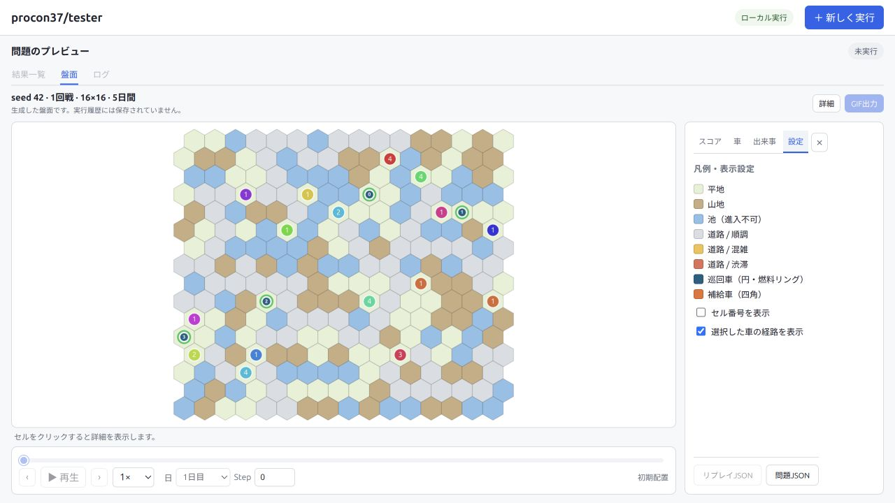
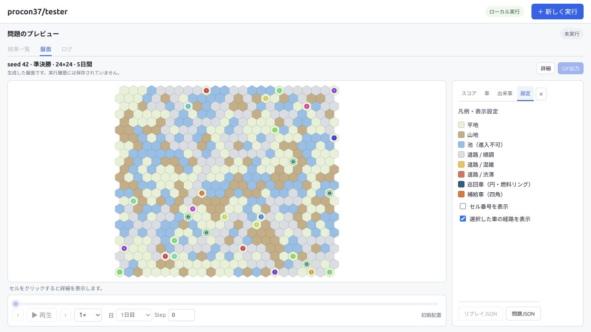
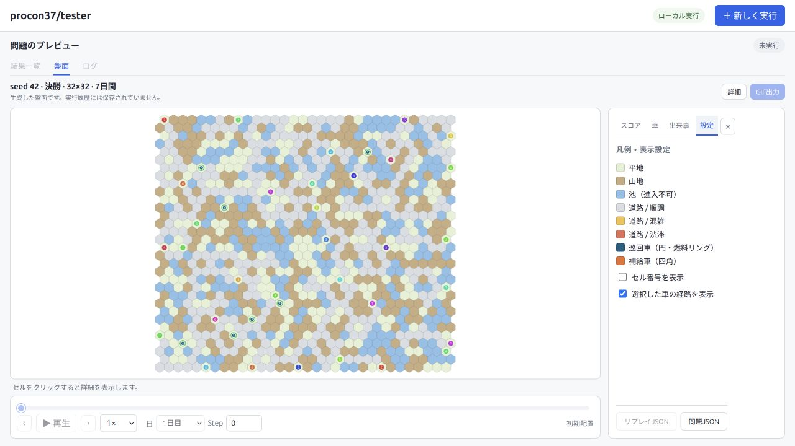

# 入力生成

GUIの問題プレビュー、GUI/CUIの試合実行、`generate` コマンドで共通して使う生成器。
現在のバージョンは **hex-udon-v24**。
取り込みは既定で有効。`--arena-maps` / `--no-arena-maps`、設定JSONの `arenaMaps`、GUIの実行設定・問題プレビューから切り替えられる。有効な場合は `seed % 4 == 3` に非公式練習場の取り込みケースを挿入する。各サイズ5枚の先頭を既存の試合 #937・#941・#916 とし、追加分は固定シャッフルした。自動形式のseed 0〜59では全15枚を各1回使用し、取り込み盤面の選択は60 seed周期で繰り返す。出典・当時の成績・正規化・再現方法は [取り込みケース](../../../common/fixtures/arena/README.md) を参照。
公式サンプル3件と挿入対象外の生成手順はv19から変更していない。以下の難易度計測はv19の結果であり、回帰ケースを含む現行v24全体の成績ではない。
生成ケースの条件は **幅広い条件20%・制約が厳しい条件80%**。日別種類数の上限未達率は、調整用26/57件（45.6%）、確認用58/120件（48.3%）だった。
計測は2026-09-21、基準ソルバ・既定55秒。変更23件を再実行し、入力が完全一致する154件は以前の結果を再利用した。

- 操作方法 → [usage.md](usage.md)
- 実装 → [../../common/src/generator.rs](../../../common/src/generator.rs)
- 公式条件 → [../../official/sample_maps/README.md](../../../official/sample_maps/README.md)
- 難易度の調整と検証 → [generator-calibration.md](generator-calibration.md)
- 現行版の日程・難易度・盤面 → [generator.md](#生成結果)
- 旧版の測定記録 → [generator.md](#過去の生成器の測定記録)

## 生成方針

本選でもサンプルと同じ生成プログラム、または共通する生成処理が使われるという仮説に立つ。
サンプルとの類似性を、本選の入力傾向に近づけるための改善目標とする。

| 再現する特徴 | 実装方針 |
| --- | --- |
| 同じ地形のまとまり | 小さな配置単位を隣接させ、自然に合体させる |
| 概ね同程度の地形比率 | 道路は23〜31%を目標とし、残りを盤面ごとに比率を変えて配分 |
| 幅1の道路 | 細い経路を伸ばし、帯状に太くなる配置を禁止 |
| 外周にも広がるスポット | 全体からの一様配置と、外周・間隔を意識した配置を混ぜる |
| スポットへの道路アクセス | 未接続のスポットから道路を作る |
| スポット間の接続 | 別のスポット・既存道路との接続で経路を終了 |
| 日別ステップ数の増加傾向 | 主に公式の最小値から始め、翌日以降の増加幅を抽選。同値も許可 |

生成プログラムの共通性は公式に確認された事実ではない。同じプログラムでも、seed・試合設定・自動調整によって入力は変わる。
公式条件の充足を必須とし、サンプルから観測した傾向は生成器の設計・評価に利用する。
サンプルに似た特徴とケースの多様性を両立する。対策用のケース集合として、基準ソルバが日別種類数の上限に届かない生成ケースを45〜55%含めることを目標に、試合条件の分布を評価する。増加傾向を弱めて未達率を合わせることはしない。
幅広い条件と制約が厳しい条件を混ぜ、全体のステップ数の許容範囲は維持する。生成時にソルバを実行したり、得点でケースを選別したりはしない。

## 生成の流れ

```text
配置方式を抽選（一様配置20%／外周・間隔を意識した配置80%）
    ↓
地形を配置し、地形とは独立にスポット位置を選ぶ
    ↓
道路に未接続のスポットを選ぶ ← 未接続スポットが残る間は繰り返す
    ↓
隣接セルから細い道路を伸ばす
    ↓
道路面積が不足する場合は既存道路を延長
    ↓
通行可能領域を連結し、車両を配置
    ↓
条件を検査して出力
```

### 1. 地形とスポット

| 処理 | 規則 |
| --- | --- |
| 地形比率の選択 | 平地・山地・池それぞれに3〜5の重みを抽選 |
| 地形の選択 | 現在のセル数÷重みが最少の地形。同数ならランダム |
| 地形の配置 | 未配置セルから隣接セルへ、1〜2セル単位で広げる |
| スポットの配置 | 下記の2方式を混合。いずれも地形によらず、重複なく位置を選ぶ |
| スポットの地形 | 平地に変更し、道路による上書きを禁止 |

地形の重みは盤面ごとに変える。道路の上書き・スポットの平地化・連結補正が加わるため、最終比率が重みと完全に一致するわけではない。

1〜2セルは配置単位であり、最終的な塊の上限ではない。同じ地形が隣接すると合体し、数セル〜十数セル、場合によっては数十セル以上になる。

#### スポットの配置方式

盤面幅とスポット数を `W` とする。試合条件の区分とは独立に、ケースごとに方式を抽選する。

| 方式 | 割合 | 位置の選び方 |
| --- | ---: | --- |
| 一様配置 | 20% | 盤面全体から重複なく一様抽選 |
| 外周・間隔を意識した配置 | 80% | 下記の手順で、外周にも広がる配置を作る |

1. 外周のスポット数を `W/4〜W/2` から抽選し、残りを内側に置く。外周は最外行・最外列のセルを指す。
2. 位置を選ぶときの候補数を1〜3から抽選する。外周・内側の配置順もシャッフルする。
3. 該当領域の未使用セルから候補を抽選し、配置済みスポットまでの最短距離が最も大きい候補を選ぶ。

距離は地形を無視した六角格子上の距離。最小間隔を固定する規則ではなく、候補数1なら通常のランダム配置になるため、近接するスポットも残る。
地形・道路の検査に適合しない場合は配置を作り直す。得点による選別は行わない。


### 2. 道路

1. スポットをランダムな順に調べる。
2. 道路に隣接済みなら、そのスポットを起点から除外する。
3. 未接続なら、隣接セルから道路を伸ばす。
4. 途中で道路に隣接したスポットも、次の起点にしない。

| 項目 | 規則 |
| --- | --- |
| 方向 | 直進を他方向の2倍の重みで抽選 |
| 終了条件 | 起点側とは別のスポットへの隣接、道路への合流、行き止まり、長さの上限 |
| 長さの上限 | 盤面幅の半分〜2倍から抽選 |
| 面積の目標 | 全体の23〜31%から抽選 |
| 起点付近 | スポットに隣接する1〜2セルから離れる向きに伸ばし、そのスポットの周りを回り続けない |
| 面積が不足する場合 | スポットに隣接していない既存道路の隣から延長。独立した起点は追加しない |

起点付近で1セルだけ接するか、もう1セルまで接する動きを許すかは、経路ごとに半々で抽選する。別経路が同じスポットに到達することは許し、スポット全体の道路隣接数には固定の上限を設けない。

経路単位で追加するため、面積の目標値を超える場合がある。別のスポットへの到達は必須ではなく、スポット1個だけに接する道路も生じる。

**幅1の判定：**

| 形 | 扱い |
| --- | --- |
| 道路3セルによる単独の三角形 | 曲がり・分岐として許可 |
| 辺を共有する2つの三角形 | 道路が太くなる最小形として禁止 |
| 道路網が複数の成分に分かれる | 許可 |

### 3. 連結補正・車両配置・検査

通行可能セルが分断されている場合、変更する池のセル数を最小化して平地へ変える。
車両の初期位置は、スポット以外の平地から抽選する。

| 検査 | 条件 |
| --- | --- |
| スポット | すべて道路に隣接 |
| 地形比率 | 各地形が15〜38% |
| 車両 | 必要な数の初期位置用平地を確保 |
| 不適合時 | 配置を作り直す。128回で生成できなければエラー |

比率の許容範囲は、約25%ずつを目指すローカル生成器の設定であり、公式の制約ではない。

## 形式・公式サンプル

形式を省略すると `seed % 3` により1回戦・準決勝・決勝を選ぶ。
次の組み合わせは、形式自動決定・明示指定のどちらでも公式サンプルを使う。

| seed | 形式 | サイズ |
| --- | --- | --- |
| 0 | `first` | 16×16 |
| 1 | `semifinal` | 24×24 |
| 2 | `final` | 32×32 |

サンプルはプレイヤー数だけ1に変更する。この3件には上記の地形・道路制約を適用しない。それ以外の組み合わせで上記の生成方法を用いる。

## 試合条件

| 項目 | 乱数生成時の設定 |
| --- | --- |
| 日数 | 4〜10 |
| 日別ステップ数 | 主に幅＋高さの最小値から開始し、翌日以降の増加幅を抽選。その4倍までの範囲で単調非減少 |
| 燃料上限 | 初日のステップ数〜その3倍の公式範囲内。条件区分によって上限を変える |
| 混雑・渋滞基準 | 混雑1〜5、渋滞2〜10、かつ混雑＜渋滞。条件区分によって抽選対象を変える |
| 系列数 | 形式ごとの公式範囲 |
| 系列割り当て | 各系列に最低1スポット。残りは系列を一様抽選 |
| 在庫 | 1〜車両数 |

これらの抽選分布はローカルテスト用の設定。同じ生成プログラムを想定しても、本選の試合設定までサンプルと同一とは限らない。

### 条件の混合

各ケースで次のどちらかを抽選する。盤面幅を `W`、初日のステップ数を `S` とする。

| 項目 | 幅広い条件（20%） | 制約が厳しい条件（80%） |
| --- | --- | --- |
| 初日のステップ数 | 2W〜8W | 2W（公式の最小値） |
| 増加幅の基準 | floor(W/16)〜floor(7W/16) | floor(W/16)〜floor(7W/16) |
| 燃料上限 | S〜3S | S〜floor(1.25S) |
| 混雑基準 | 1〜5 | 1〜2 |
| 渋滞基準 | 2〜10 | 2〜4 |

いずれも整数を一様抽選し、混雑・渋滞基準は混雑＜渋滞を満たす組から選ぶ。条件区分は独立した乱数系列で選び、特定のseed番号や形式に難易度を割り当てない。
制約が厳しい条件でも、日程・燃料・混雑の組み合わせを変える。日数は4〜10から選び、各日のステップ数が2W〜8Wに収まる範囲で増加幅を抽選する。
混合率80%は上限未達率80%を意味しない。各ケースで独立に抽選するため、有限個のseedで混合率がちょうど20%・80%になるわけではない。

- 基準ソルバでの実測・既存seed集合での比較 → [generator-calibration.md](generator-calibration.md)

v14以降は、公式サンプル3件がいずれも最小値から始まる点を反映した。v19では多様な試合条件を増やすため、幅広い条件を8%から20%に変更した。最小値始まりを主体にしつつ、大きな初期値も残す。各区分のステップ数・燃料・混雑の抽選範囲と盤面の生成規則はv17と同じ。

### 日別ステップ数の増加傾向

公式サンプルはいずれも日別ステップ数が減らず、3日目と4日目は同じ値になっている。

| サイズ | 1日目 | 2日目 | 3日目 | 4日目 | 5日目 |
| --- | ---: | ---: | ---: | ---: | ---: |
| 16×16 | 32 | 36 | 40 | 40 | 48 |
| 24×24 | 48 | 56 | 68 | 68 | 72 |
| 32×32 | 64 | 76 | 88 | 88 | 100 |

公式サンプルの初日は、全形式で下限の `2W`。v12は日程の中央から前後へ増減させていたため、最小値より大きく始まるケースが約半数あった。v14以降は初日から順に生成する。
前日・前々日の滞在状況によって道路が混雑・渋滞しうるため、後半の行動余裕を増やす。実際の道路状態を見てステップ数を動的に変える処理ではない。

| 手順 | 設定 |
| --- | --- |
| 初日を決める | 厳しい条件は2W。幅広い条件は2W〜8Wの整数を一様抽選 |
| 試合ごとの増加幅の基準 `G` を決める | floor(W/16)〜floor(7W/16)の整数を一様抽選。条件区分とは独立 |
| 翌日以降を生成する | 原則0〜2Gの整数を一様抽選し、前日のステップ数に足す |
| 上限に近づいた場合 | 上限8Wまでの余裕を `H`、残りの増加回数を `R` とし、抽選上限を `min(2G, floor(2H/R), H)` にする |

初日からの加算に合わせ、1回の増加幅の期待値が概ねW/4となる範囲を使う。最小値から始まる5日間なら、境界の影響がないときの平均的な増加量は概ねWとなる。増加量は試合ごと・日ごとに変わり、同じ値が続く日もある。
各回の抽選範囲を制約内に収め、抽選後のやり直しや値の切り詰めは行わない。大きな初期値も残すため、全日ほぼ同じ値になるケースを完全には除かない。

増加幅の基準・試合条件の区分・スポットの配置方式には独立した乱数系列を使う。日別種類数の上限未達は検証時の評価指標とし、生成時の採否条件にはしない。

## 再現性

- 乱数器はChaCha8。生成バージョン・seed・形式が同じなら同一の問題を生成する。
- 試合条件・地形・道路と配置・ステップ増加幅の基準・条件区分・スポット配置方式・分散配置の位置選択で乱数系列を分ける。
- 生成バージョンを変更した場合、同じseedでも問題が変わることがある。
- 保存済み履歴は問題本体を保持するため、生成器の更新後も当時の試合を再生できる。

```sh
# 生成例
cargo run --release -p tester -- generate --seed 42 --format final

# 生成器の検証
cargo test -p tester generator::tests
```

## 生成結果

### v19の条件と日程

各形式のseed 3〜4098、計12,288件を生成した。最小値始まりを主体にしつつ、大きな初期値も現れ、各形式で上限8Wに達する日程も確認した。
増加率は「最終日のステップ数 ÷ 初日のステップ数 − 1」で計算する。

| 形式 | 幅広い条件 | 最小値始まり | 5日間の増加率中央値 | 全日同じ値 |
| --- | ---: | ---: | ---: | ---: |
| 1回戦 | 19.8% | 80.5% | 37.5% | 0.49% |
| 準決勝 | 20.6% | 79.6% | 37.5% | 0.27% |
| 決勝 | 19.8% | 80.3% | 40.6% | 0.15% |

幅広い条件でも初日に最小値を引く場合があるため、条件の混合率と最小値始まりの割合は厳密には一致しない。
大きな初期値のケースが増えた結果、5日間の増加率中央値はv17の40.6%・41.7%・45.3%から下がった。増加幅の抽選規則は変えていない。

### v19の難易度

既定55秒の基準ソルバで、v17と同じseed集合を比較した。

| 集合 | v17の上限未達率 | v19の上限未達率 |
| --- | ---: | ---: |
| 調整用：seed 3〜59 | 31/57（54.4%） | 26/57（45.6%） |
| 確認用：seed 3000〜3119 | 64/120（53.3%） | 58/120（48.3%） |

両集合とも目標の45〜55%に収まり、合計は84/177件（47.5%）。全177件がAC・試合全体で全系列獲得・フォールバック0件だった。
入力が変わった23件を新規実行し、問題全体が一致する154件の結果を再利用した。確認用は既存seed集合の再評価であり、新しいseedでの独立検証ではない。

- 評価条件・形式ごとの内訳・記録 → [generator-calibration.md](generator-calibration.md#難易度の計測結果)

### 地形比率とスポットの接続

各形式のseed 3〜122、計360ケースの平均。v17での計測値を掲載している。v19との入力比較で、この360件の盤面・スポット配置が一致することを確認した。

| 形式 | 平地 | 道路 | 山地 | 池 | 複数スポットの接続率 |
| --- | ---: | ---: | ---: | ---: | ---: |
| 1回戦 | 28.4% | 27.6% | 21.7% | 22.4% | 91.3% |
| 準決勝 | 27.6% | 27.1% | 22.6% | 22.7% | 90.6% |
| 決勝 | 26.7% | 27.3% | 23.2% | 22.8% | 90.2% |

盤面ごとの比率には幅がある。この360件では、平地19.2〜37.2%、道路22.7〜33.2%、山地15.2〜32.8%、池15.0〜33.3%だった。サンプルの山地約18〜31%の違いも含む範囲になっている。

| 指標 | 定義・結果 |
| --- | --- |
| 道路隣接率 | 道路に隣接するスポットの割合。生成条件により100% |
| 複数スポットの接続率 | 道路＋スポットの連結成分に、2個以上のスポットが含まれる割合。スポット数で数え、マップごとの割合を平均 |
| 平地がやや多い理由 | スポットの平地化と通行可能領域の連結補正 |
| 地形の塊の中央値 | 道路以外の同一地形の連結成分を個数で数えると、全形式で2セル |
| 塊の90%が収まる大きさ | 塊を個数で数えると、1回戦では90%が6セル以下、準決勝・決勝では7セル以下。盤面面積の90%という意味ではない |

### 盤面の例

各形式のseed 42の初期配置。v17で撮影した画像だが、3形式とも問題全体がv19と一致することを確認している。1回戦は一様配置、準決勝・決勝は外周・間隔を意識した配置が選ばれている。右側に「設定」の凡例を表示している。

画像は盤面の配色変更前のもので、道路は灰色（順調時）、平地は淡緑、山地は茶色、池は青。スポットは系列ごとに色分けした円で、白い数字は在庫を表す。燃料リング付きの円は巡回車を表す。現在の配色は [GUIの盤面の表示](gui.md#盤面の表示) を参照。

#### 1回戦（16×16）



#### 準決勝（24×24）



#### 決勝（32×32）



## 過去の生成器の測定記録

以下は旧版を使った比較・調整の記録。各節に記載したバージョンの結果であり、現行v24の仕様や成績とは区別する。

### v17の難易度（混合率変更前）

v17はサンプルに合わせて道路の出入口・地形比率の幅・外周配置を見直した。日程・燃料・混雑・系列数の抽選規則はv16と同じ。上限未達率は調整用31/57件（54.4%）、設定を固定した別seedの確認用64/120件（53.3%）となり、両集合とも目標の45〜55%に収まった。全177件がACで、確認用の内訳は1回戦47.5%、準決勝65.0%、決勝47.5%だった。

- 評価条件・配置の比較・記録 → [generator-calibration.md](generator-calibration.md)

### v12の日程の増加率（変更前）

各形式のseed 3〜4098、4,096ケースで比較した。増加率は「最終日のステップ数 ÷ 初日のステップ数 − 1」であり、1日ごとの増加率ではない。

| 形式 | 全日同じ：v11 → v12 | 増加率10%以下：v11 → v12 | 5日間の増加率中央値：v11 → v12 |
| --- | ---: | ---: | ---: |
| 1回戦 | 32.4% → 0.37% | 44.2% → 2.91% | 9.4% → 46.9% |
| 準決勝 | 24.4% → 0.12% | 41.0% → 2.05% | 9.6% → 47.9% |
| 決勝 | 19.3% → 0.02% | 41.5% → 1.61% | 9.2% → 47.0% |

公式サンプルの5日間の増加率は50%・50%・56.25%。v12の5日間の集計対象は1回戦585件・準決勝575件・決勝608件で、中央値がサンプルに近づいた。すべてのケースをこの増加率に固定しているわけではない。
日数4〜10を合わせた増加率中央値は約61%。5日間の日程だけでも、25%以下と75%以上の両方が存在する。

既定55秒の同じRustソルバでseed 3〜59を比較すると、全57件がACとなり、日別種類数の上限未達率はv11の45.6%からv12の36.8%（21/57件）へ下がった。増加傾向は改善したが、未達率45〜55%の目標はこの比較集合では満たしていない。

- ソルバによる難易度評価 → [generator-calibration.md](generator-calibration.md)

### v11の難易度検証（変更前）

既定55秒のRustソルバで、調整用の上限未達率は26/57件（45.6%）、確認用は61/120件（50.8%）となった。いずれも目標の45〜55%に収まった。
調整用は同一入力54件の既存結果を再利用している。確認用は当初60件の58.3%を受け、混合率を固定したまま120件へ拡大した。部分集合や形式ごとにはばらつきがある。

- 検証条件・結果の内訳・入力分布 → [generator-calibration.md](generator-calibration.md)

### v9の日程の分布

各形式のseed 3〜4098、4,096ケースで確認した。日程の棄却は行っていない。

| 形式 | 全日3W以下 | 全日7W以上 | 日程の平均値（W単位） |
| --- | ---: | ---: | ---: |
| 1回戦 | 337（8.23%） | 330（8.06%） | 5.02 |
| 準決勝 | 299（7.30%） | 306（7.47%） | 5.01 |
| 決勝 | 293（7.15%） | 295（7.20%） | 4.96 |

v8にあった短い側・長い側の大きな非対称性は、この検証では見られない。各日数4〜10でも別々に集計した。
単体テストでは各形式・各日数につき4,096seedを使い、両端の件数差と、日程を反転した位置同士の平均値を検査する。中央の値の保持、単調非減少、上下限、短め・長め・一定・増加する日程の存在も確認する。

これは上下対称な分布の検証であり、すべての日程パターンを一様に生成することや、有限個のseedで短い側と長い側の件数を一致させることを目的とはしない。

### v9のソルバ検証

2026-09-20、v7・v8と同じサンプルソルバv27でseed 0〜59を形式自動選択・4ケース並列・既定の制限時間で実行した。**60件すべてAC**。
日別種類数はサンプル3件が49/60・87/90・117/120、生成57件はすべて上限到達だった。短い側・長い側の分布は改善したが、通常60件での得点の飽和は解消していない。

- 実行ID：`1789881690799116854-2`
- v8との入力比較：通常60件で、日別ステップ数・燃料上限以外は一致。公式サンプル3件は問題全体が一致。
- 単体テスト39件・Clippyが通過。GUIとdebug/releaseのCUIは、各形式のseed 42で同じv9問題を生成。

### v8の日程の分布

各形式のseed 3〜514、512ケースで確認した。分類は重複する。

| 形式 | 全日3W以下 | 全日7W以上 | 全日同値 | 初日から最終日までW以上増加 |
| --- | ---: | ---: | ---: | ---: |
| 1回戦 | 25 | 98 | 73 | 247 |
| 準決勝 | 19 | 90 | 49 | 225 |
| 決勝 | 22 | 68 | 34 | 257 |

v8では全形式で初期値の最小・最大が2W・8Wだったが、全日が短めに収まるケースより、長めに収まるケースが多くなった。この偏りをv9で見直した。

### v8のソルバ検証

2026-09-20、下記v7評価と同じサンプルソルバv27を用い、seed 0〜59を形式自動選択・4ケース並列・既定の制限時間で実行した。**60件すべてAC**。
通常60件のうち、生成57件は引き続き日別種類数の上限に達した。サンプル3件は49/60・87/90・117/120で、v7評価と同じだった。

通常60件には全日3W以下の生成ケースがなかったため、その区分を追加検証した。各形式についてseed 60から昇順に調べ、全日3W以下となる最初の3ケースを、ソルバの得点を見る前に選んだ。

| 形式 | 追加したseed | 上限未達の件数 |
| --- | --- | ---: |
| 1回戦 | 71・89・106 | 1 |
| 準決勝 | 76・77・100 | 0 |
| 決勝 | 60・119・125 | 0 |

追加9件もすべてAC。1回戦・seed 89は全10日が37ステップで、日別種類数は **119/120** だった。
上限未達の生成ケースの存在は確認できたが、通常60件の得点の飽和は解消していない。追加分は短い日程を対象とした検証であり、1/9を全生成ケースでの未達率とは扱わない。

- 通常60件の実行ID：`1789880799056805260-2`
- seed 89の実行ID：`1789880983485601795-60`
- v7との入力比較：通常60件で、日別ステップ数・燃料上限以外は一致。公式サンプル3件は問題全体が一致。
- GUIとdebug/releaseのCUIが、各形式のseed 42で同じv8問題を生成することを確認。

### v7のソルバ検証（比較元）

2026-09-20、指定されたサンプルソルバv27の実行ファイルを固定し、v7のseed 0〜59を形式自動選択・4ケース並列・既定の制限時間で実行した。60件すべてAC。
日別種類数の上限は「系列数×日数」とする。この値に届かない場合、少なくとも1日は全系列を獲得できていない。

| 対象 | 件数 | 日別種類数が上限未達の件数 |
| --- | ---: | ---: |
| 公式サンプル（seed 0〜2） | 3 | 3 |
| 生成・1回戦 | 19 | 0 |
| 生成・準決勝 | 19 | 0 |
| 生成・決勝 | 19 | 0 |

サンプルの日別種類数は、1回戦49/60、準決勝87/90、決勝117/120。生成57件はすべて上限に達した。
この評価範囲では、単調非減少への変更だけではサンプルとの得点傾向の差は解消していない。
得点面の多様性は今後の検証課題とし、サンプルへの類似性と入力の多様性の両方から生成方針を検討する。

検証条件の識別情報：

- 実行ID：`1789879782653536388-2`
- ソルバ実行ファイルのSHA-256：`8814b0edd4833f85f7e6ac7bfcc347af45301d90dfa3f7423ae657bbf87399ca`
- ソルバは実時間で探索を打ち切るため、同じ入力でも得点が変動する場合がある。


### 塊の大きさの改善

v5の4〜16セル単位では、チャンクの合体後に塊が大きくなりすぎた。
v6では配置単位を1〜2セルへ縮小した。

比較指標は、地形からランダムに1セル選んだとき、そのセルが属する塊の平均サイズ。
`Σ(成分サイズ²) / Σ(成分サイズ)` で計算し、大きな塊の影響を反映する。

生成側は各形式seed 3〜62の60ケース平均。表内は **平地／山地／池** の順。

| サイズ | 公式サンプル | v5 | v6 |
| --- | --- | --- | --- |
| 16×16 | 6.7 / 3.4 / 4.7 | 17.6 / 12.7 / 13.2 | 6.7 / 5.7 / 5.3 |
| 24×24 | 8.9 / 5.8 / 5.1 | 20.4 / 18.5 / 17.7 | 7.7 / 6.8 / 6.6 |
| 32×32 | 6.0 / 8.0 / 6.9 | 23.7 / 24.2 / 20.1 | 8.3 / 7.4 / 7.3 |

サイズ別の補正係数は使用していない。
サンプルへの類似性の改善は、本選と共通する生成傾向に近づいたと評価する材料になる。
ただし、サンプルは調整にも使っているため、複数seedのばらつきや今後得られる入力でも検証する。
