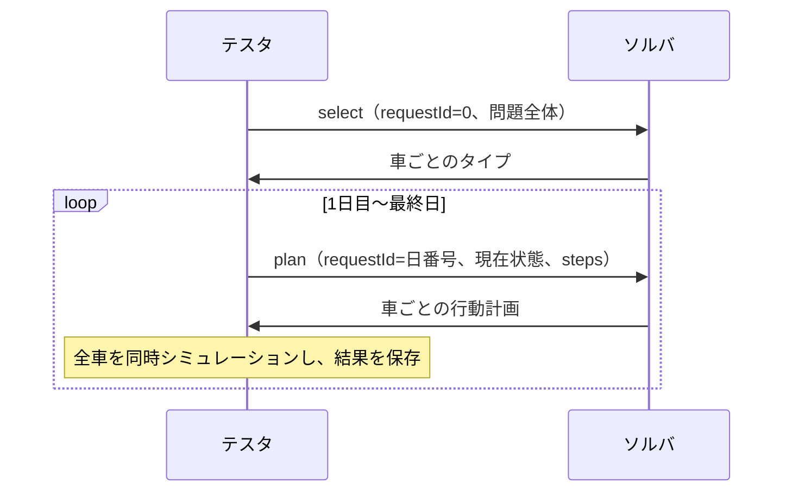

# ソルバ通信仕様 v1

- テスタの入口 → [../README.md](../README.md)
- 実行設定 → [usage.md](usage.md#コマンド設定)
- シミュレーションの設計 → [tester-design.md](tester-design.md#シミュレーション)
- ソルバの実装例 → [../../main.rs](../../../main.rs)
- データ型 → [../../common/src/model.rs](../../../common/src/model.rs)

## 通信の基本規則

| 項目 | 規則 |
| --- | --- |
| プロセス | 1試合につき1プロセス。タイプ選択から最終日まで維持 |
| 通信 | stdin/stdoutでUTF-8のJSON Lines（1行1JSON） |
| stdout | 回答専用。回答の末尾に改行を付け、必ずflush |
| stderr | デバッグログ用 |
| 要求ID | 受け取った `requestId` をそのまま返す |
| 回答回数 | 1要求1回答。改善回答の再提出は受け付けない |

## 通信の流れ



不正回答の場合も代替動作で試合を進め、次の要求にはその結果を渡す。

## タイプ選択

### テスタからの要求

以下の `problem` は省略表記。実際には `model::Problem` の公式形式データ全体を含む。読みやすさのための改行は、実際の通信では除く。

```text
{
  "protocolVersion": 1,
  "requestId": 0,
  "phase": "select",
  "timeLimitMs": 60000,
  "problem": {...}
}
```

| フィールド | 意味 |
| --- | --- |
| `protocolVersion` | 通信仕様のバージョン。現在は1 |
| `requestId` | タイプ選択では0 |
| `phase` | `"select"` |
| `timeLimitMs` | 今回の回答期限までの時間（ミリ秒） |
| `problem` | 地形、スポット、初期位置、日程など |

### ソルバの回答

`answer` はエージェント順の配列。**0＝巡回車、1＝補給車**。

```json
{"requestId":0,"answer":[0,0,0,1]}
```

## 日別計画

### テスタからの要求

以下は一部省略した構造例。実際の通信は1行で送る。

```text
{
  "protocolVersion": 1,
  "requestId": 1,
  "phase": "plan",
  "timeLimitMs": 60000,
  "state": {
    "endsAt": ...,
    "day": 0,
    "agents": [...],
    "others": [],
    "traffics": [...]
  },
  "steps": 64,
  "previousAccepted": true
}
```

| フィールド | 意味 |
| --- | --- |
| `requestId` | 1日目が1、以後1ずつ増加 |
| `state.day` | 完了済みの日数。1日目の要求では0 |
| `state.endsAt` | 目安のUNIX秒の締切。厳密な制限は `timeLimitMs` |
| `state.agents` | 車ごとの `{kind, pos, fuel}` |
| `state.others` | 常に空配列 |
| `state.traffics` | 道路セルごとの `{pos, status}`。順調0／混雑1／渋滞2 |
| `steps` | その日の全行動が使うべきステップ数 |
| `previousAccepted` | 直前の回答の採否 |

状態は、前回の回答または代替動作を適用した後の実状態。却下された計画の途中状態は含まない。

### ソルバの回答

4台が64ステップずつ待機する例：

```json
{"requestId":1,"answer":[[-64],[-64],[-64],[-64]]}
```

`answer` は車順の配列、その内側は行動順の整数配列。

| 行動値 | 動作 |
| --- | --- |
| 0 / 1 / 2 | 左上 / 右上 / 右へ移動 |
| 3 / 4 / 5 | 右下 / 左下 / 左へ移動 |
| 負数 | 絶対値のステップ数だけ待機。例：`-8` は8ステップ |

座標は偶数行が右にずれる六角形グリッド、位置IDは `y * width + x`。

## 行動時間と燃料

**各車の行動時間の合計を、その日の `steps` と一致させる。** 移動時間・燃料は移動元セルの地形で決まる。

| 移動元 | 必要ステップ | 巡回車の燃料消費 |
| --- | ---: | ---: |
| 平地 | 2 | 1 |
| 山地 | 3 | 2 |
| 道路・順調 | 1 | 2 |
| 道路・混雑 | 2 | 2 |
| 道路・渋滞 | 4 | 2 |
| 池・盤外 | 移動不可 | — |
| 待機 | 指定した絶対値 | 0 |

補給車は燃料を消費しない。

燃料は移動反映の直前に引く。予約時点で不足していても、反映前の途中ステップに出発セルで補給されれば有効。同じ反映ステップの燃料消費より後に行われる補給は先取りできない。公式補足資料の巡回車Aを回帰テストにしている。

## 不正回答・制限時間

| 状況 | 処理 |
| --- | --- |
| 不正なタイプ選択 | 全車を巡回車にする |
| 1台でも不正な計画、時間切れ、回答不能 | 当日の全車を全ステップ待機にする |
| 時間切れ後の古い要求ID | 読み捨てる |
| 未来の要求ID、不正JSON、1 MiBを超える回答行 | 不正回答として扱う |
| 改行前にプロセス終了 | 有効な回答として扱わない |
| プロセスが生きている | 次の要求を送る |
| プロセスが終了済み | 試合途中で再起動せず、以後も代替動作 |

計画は状態のコピー上で全車を同時に検証する。失敗時は途中の変更を採用しない。代替動作でも獲得・補給・交通量の通常処理を行う。

| 時間制限 | 既定値 |
| --- | --- |
| タイプ選択 | 1回戦60秒／準決勝90秒／決勝120秒 |
| 日別回答 | 各日60秒 |
| テスト用の変更 | `--time-limit-ms`。要求の `timeLimitMs` に反映 |

計測は要求送信開始から回答受信までの実時間。複数スレッドのCPU時間は合算しない。

- 判定ラベルの意味 → [usage.md](usage.md#結果と判定を読む)
