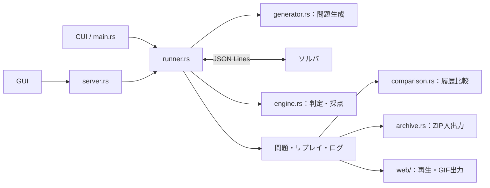

# テスタ・ビジュアライザの設計

Rust製テスタとHTML製ビジュアライザの構成・責務・判定処理をまとめる。

- 操作方法 → [usage.md](usage.md)
- ソルバとの通信仕様 → [protocol.md](protocol.md)
- 問題の生成方法 → [generator.md](generator.md)

## 基本方針

| 項目 | 方針 |
| --- | --- |
| 対象 | 自分1プレイヤーの試合。`players=1` |
| 形式 | 1回戦・準決勝・決勝。エージェント数は形式に従う |
| 実行 | 既定60seed。バッチ前に一度ビルドし、1試合につき1ソルバプロセス |
| 通信 | JSON Lines。タイプ選択・各日とも1要求1回答 |
| GUI/CUI | 同じ生成・判定・保存処理を利用 |
| GUIの範囲 | 実行・比較・再生・GIF出力・履歴管理。手動の行動計画作成は対象外 |
| 既定ソルバ | `main.rs` が通信、`solver/` が探索を担当。C++版「戦略9」のRust移植 |

「形式」は試合区分を指す。車両タイプや獲得したうどんの種類数とは区別する。

## 全体構成



Cargo workspaceのルートにソルバ、`tester/solo/` に単独テスタ、`tester/game/` に対戦テスタ、`common/` に共通実装を置く。単独テスタのCargoパッケージ名は `tester` のまま、共通実装を再公開して既存の公開パスを維持する。
HTML側では採点やシミュレーションを再実装せず、Rustが出力した状態とイベントを描画する。

## 実装一覧

| 実装 | 担当 |
| --- | --- |
| [model.rs](../../../common/src/model.rs) | 問題・通信・リプレイの型、座標、入力検証 |
| [generator.rs](../../../common/src/generator.rs) | 決定的な問題生成 |
| [engine.rs](../../../common/src/engine.rs) | 行動検証、シミュレーション、採点 |
| [runner.rs](../../../common/src/runner.rs) | ビルド・プロセス管理・バッチ実行・保存 |
| [comparison.rs](../../../common/src/comparison.rs) | 保存された問題の照合・履歴比較 |
| [report.rs](../../../common/src/report.rs) | CUIの集計・表示 |
| [archive.rs](../../../common/src/archive.rs) | 履歴ZIPの入出力・検証 |
| [main.rs](../src/main.rs) / [server.rs](../../../common/src/server.rs) | CUI / ローカルHTTP API |
| [web/](../../../common/web/) | 履歴・比較・リプレイ表示、GIF出力 |
| [desktop/](../desktop/) | Linux/WSLの登録・起動・再起動 |

## 実行とプロセス管理

### バッチの流れ

1. 実行設定を検証し、指定されたソルバを一度ビルドする。
2. seedごとに問題を生成し、ソルバプロセスを起動する。
3. タイプ選択、各日の計画要求、判定を順に行う。
4. ケースの得点・回答・リプレイ・ログを保存する。
5. バッチの状態と全体・形式別サマリーを更新する。

| 制御 | 設計 |
| --- | --- |
| コマンド | 本体と引数を分け、シェル展開せず実行 |
| 同時seed数 | 内部並列なしならCPU数と件数から決定、内部並列ありなら1。設定で上書き可能 |
| ソルバ内部のスレッド数 | テスタでは制限しない。引数・環境変数で指定 |
| 時間計測 | 要求送信開始から回答受信までの実時間 |
| stdout / stderr | 別々に継続読取。ログ出力による待ち合わせを防ぐ |
| 終了・中断 | プロセスを終了・回収。Linux/WSL/macOSでは子プロセスもプロセスグループで停止 |

- 実行設定のフィールド → [usage.md](usage.md#コマンド設定)

### 異常時の動作

| 状況 | 動作 |
| --- | --- |
| ビルド失敗 | CEを保存。ケースを開始しない |
| 不正なタイプ選択 | 全車巡回車を採用 |
| 不正な日別計画 | その日の全車を待機へ置換 |
| 時間切れ | 代替動作で続行。古い要求IDの回答を読み捨てる |
| ソルバ終了 | 試合途中で再起動せず、残りの日も代替動作で完了 |
| テスタ側の保存失敗など | バッチを中断し、原因を記録 |

計画は状態のコピー上で検証する。却下した計画の途中状態を本番状態へ混ぜない。
得点とAC/WA/TLE/REの判定は別に保存する。

## シミュレーション

### ステップ内の順序

```text
0ステップ目：行動予約のみ

1〜最終ステップ：
  燃料消費 → 移動反映 → うどん獲得 → 補給 → 交通量更新
  → 次の行動予約（最終ステップでは行わない）
```

| 項目 | 処理 |
| --- | --- |
| 座標 | 偶数行が右にずれる六角形。位置IDは `y * width + x` |
| 方向 | 左上から時計回りに0〜5 |
| 移動時間・燃料 | 移動元の地形・当日の道路状態で決定 |
| 待機 | 指定ステップ数。地形によらず燃料消費なし |
| 移動中の位置 | 反映までは出発セルに滞在 |
| 燃料不足 | 移動反映直前の消費時に判定。予約後、反映前の補給は利用可能 |
| 在庫競合 | エージェント配列の小さい添字を優先 |
| 獲得上限 | 同じ巡回車が同日に同じスポットから得るうどんは1玉まで |

池・盤外への移動、ステップの過不足、燃料不足を全車の同時進行で検証する。

- 行動時間・燃料の数値 → [protocol.md](protocol.md#行動時間と燃料)

### 日の境界

| 状態 | 日付が変わるとき |
| --- | --- |
| 位置・燃料 | 前日から引き継ぐ。初日の巡回車は満タン |
| 在庫 | 最大在庫へ補充 |
| 訪問履歴 | 当日の獲得済みスポットをリセット |
| 道路状態 | 前日と前々日の滞在ステップ数を全車で合算し、プレイヤー数1で割って決定 |
| 初日の道路 | すべて順調 |
| 日中の道路 | 当日は固定 |

## 評価・保存・画面の分担

| 項目 | 設計 |
| --- | --- |
| 得点 | 試合全体の種類数、日別種類数の合計、玉数を別々に保持 |
| 時間 | 受理した日別回答時間を合計。タイプ選択時間は別の診断情報 |
| 比較の勝敗 | 種類数 → 日別種類数 → 玉数。回答時間は別表示 |
| 比較の対象 | 保存された問題本体・形式が一致し、全履歴でACのケース |
| リプレイ | 問題・採用行動・状態・結果を保存し、閲覧時には再実行しない |
| ZIP取り込み | パス・容量・問題と結果の整合を検証後、新規IDで追加。記録中のコマンドは実行しない |
| GUI | ローカルHTTP。HTML/CSS/JSを実行ファイルに同梱 |

任意の重み付き単一スコアには変換しない。代替動作の得点も保存するが、共通ACの比較には含めない。

- 保存JSON・ZIPの仕様 → [history.md](history.md)

画面では新規実行設定と履歴閲覧を分離する。配色とCanvas描画は `procon37-summer/web` を流用している。
生成器・画面の変更後は再ビルドとサーバー再起動が必要。

- 変更をGUI/CUIへ反映する手順 → [setup.md](setup.md#変更をguicuiへ反映する)

## サンプルと公式資料の位置づけ

公式条件の充足を必須とする。そのうえで、本選とサンプルが共通の生成処理を使うという仮説から、道路・地形・スポット配置の特徴を近づける。
サンプルとの類似性は、本選の入力傾向を推測・再現するための評価材料となる。

生成プログラムの共通性や設定の一致は公式保証ではない。

- 生成方針と検証結果 → [generator.md](generator.md)
- 参考マップのお知らせ：形式ごとの条件、参考マップと本選の違い → [../../official/sample_maps/README.md](../../../official/sample_maps/README.md)
- 16×16：公式サンプル入力 → [../../official/sample_maps/sample_16.json](../../../official/sample_maps/sample_16.json)
- 24×24：公式サンプル入力 → [../../official/sample_maps/sample_24.json](../../../official/sample_maps/sample_24.json)
- 32×32：公式サンプル入力 → [../../official/sample_maps/sample_32.json](../../../official/sample_maps/sample_32.json)
- 募集要項：8〜12ページのマップ・車両・交通量・在庫・勝敗 → [../../official/令和8年度香川（高松）大会募集要項.pdf](../../../official/令和8年度香川（高松）大会募集要項.pdf)
- フォーマット：問題・日別状態・回答のJSON → [../../official/競技部門「ヘキサうどん_」のフォーマットについて.pdf](../../../official/競技部門「ヘキサうどん_」のフォーマットについて.pdf)
- Q&Aその1：座標・処理順・試合パラメータの範囲 → [../../official/第37回大会競技部門問い合わせと回答その１.pdf](../../../official/第37回大会競技部門問い合わせと回答その１.pdf)
- Q&Aその2：補給・在庫競合・交通量・初期位置など → [../../official/第37回大会競技部門問い合わせと回答その２.pdf](../../../official/第37回大会競技部門問い合わせと回答その２.pdf)
- Q&Aその3：燃料上限の範囲 → [../../official/第37回大会競技部門問い合わせと回答その3.pdf](../../../official/第37回大会競技部門問い合わせと回答その3.pdf)
- 行動詳細の補足資料：フェーズ順序・具体例 → [../../official/第37回大会競技部門問い合わせと回答_補足資料(行動詳細).pdf](<../../../official/第37回大会競技部門問い合わせと回答_補足資料(行動詳細).pdf>)

## 検証項目

| 対象 | 確認内容 |
| --- | --- |
| 座標・移動 | 行の偶奇、全6方向、盤端、地形別コスト、待機、最終ステップ |
| 同時処理 | 公式補足例、滞在位置、獲得と補給の順序、同時到着、在庫競合 |
| 日境界 | 満タン・道路順調、位置と燃料の引継ぎ、在庫補充、交通量 |
| 不正回答 | JSON・配列長・範囲・移動・時間・燃料の検査、全体却下と状態維持 |
| プロセス | ビルド失敗、終了・時間切れ、古い回答、大量stderr、内部並列、終了時の回収 |
| GUI/CUI共通処理 | 同じ問題・回答で採用行動・得点・リプレイが一致。実時間の一致は要求しない |
| 生成 | 決定性、公式サンプルの保持、地形比率・塊、道路幅、スポット隣接 |
| 履歴 | 同一問題の比較、ZIP往復、取り込み検証、実行中の削除拒否 |
| 画面・起動 | 画面遷移、GIFの色・時間、サーバーの再利用・再起動 |
| 一連の動作 | ビルド→60seed実行→結果選択→再生→保存結果の再読込 |

- 検証コマンド → [../README.md](../README.md#検証)
